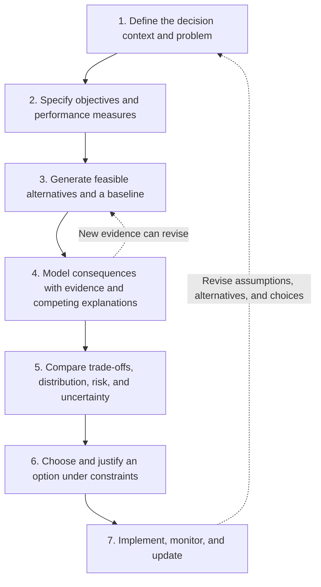
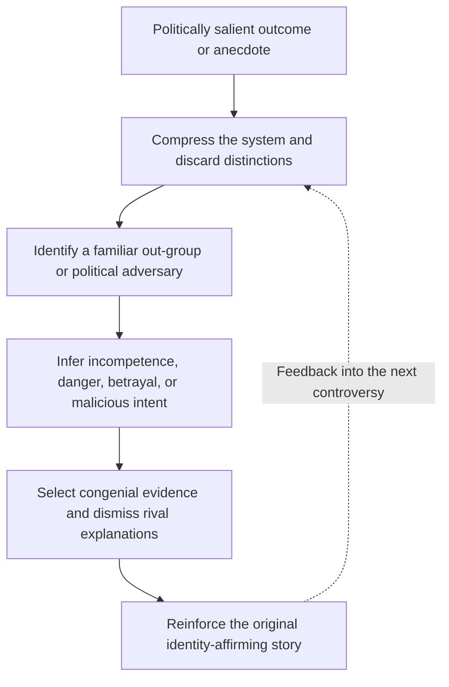
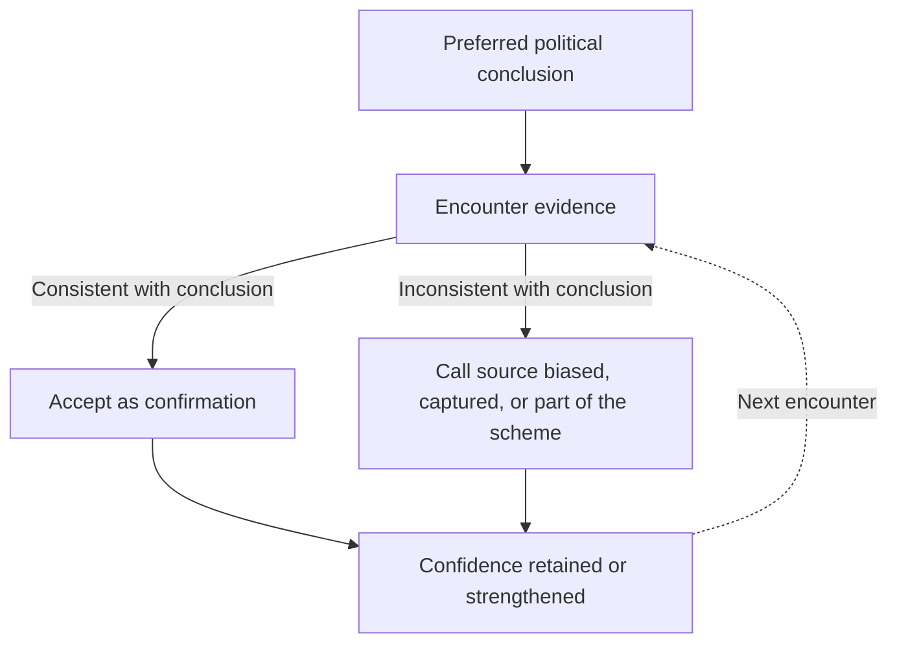

# MAGA Brain Rot: When Grievance Replaces Reasoning

*How high-speed rail and immigration arguments expose failures of causal inference, decision theory, and public reasoning*

## Table of Contents

1. [I. The Anatomy of MAGA Brain Rot](#section-i)
2. [II. What Rational Policy Discussion Actually Requires](#section-ii)
   - [The reference decision process](#the-reference-decision-process)
   - [The minimum standard for everyday arguments](#the-minimum-standard-for-everyday-arguments)
   - [Departures from rational normativity](#the-specific-departures-from-rational-normativity)
3. [III. High-Speed Rail: From Infrastructure to Conspiracy](#section-iii)
   - [Causal inference and competing explanations](#a-causal-inference-test-overruns-are-not-evidence-of-motive)
   - [The missing counterfactual](#the-missing-counterfactual)
   - [Three questions, three bodies of evidence](#three-questions-three-bodies-of-evidence)
4. [IV. The Future Doesn't Vote: The Missing Generational Perspective](#section-iv)
   - [Intergenerational social welfare](#a-formal-account-of-intergenerational-social-welfare)
   - [Three evaluation problems](#three-different-evaluation-problems)
5. [V. Immigration: When a Population Becomes a Scapegoat](#section-v)
   - [Six recurring reasoning failures](#the-six-recurring-failures-in-immigration-arguments)
   - [A multi-criteria immigration policy framework](#what-a-genuine-immigration-policy-evaluation-would-measure)
   - [A. Open borders and motive attribution](#immigration-a)
   - [B. Economic claims and distribution](#immigration-b)
   - [C. Crime, probability, and screening](#immigration-c)
   - [D. Assimilation into what?](#immigration-d)
   - [E. Evidence from Europe and China](#immigration-e)
   - [F. Political grievance](#immigration-f)
6. [VI. One Machine, Two Issues: The Common Reasoning Pattern](#section-vi)
   - [The shared reasoning pattern](#the-common-structure-visualized)
   - [The disappearance of policy as a decision problem](#the-deeper-failure-the-disappearance-of-policy-as-a-decision-problem)
7. [VII. Why Brain Rot Is More Than Ordinary Political Ignorance](#section-vii)
   - [Epistemic closure and conversational tests](#how-an-argument-becomes-self-sealing)
8. [VIII. Conclusion: When Politics Stops Being About Solving Problems](#section-viii)
9. [Appendix: The Common Reasoning Pattern, Side by Side](#appendix)

---

## I. The Anatomy of MAGA Brain Rot

Ask why California's high-speed rail project has become so expensive and taken so long, and a familiar answer emerges: Democrats are corrupt, incompetent, and wasting taxpayer money. Ask what immigration policy ought to look like, and the response is similarly predictable: liberals want "open borders" (whatever that means), immigrants are bringing crime, and they're destroying American culture. These are very different policy problems, yet the explanations follow remarkably similar patterns.

I call this **MAGA brain rot**: a recurring form of political discourse in which complex problems are reduced to narratives of blame, conspiracy, cultural threat, and grievance. The term describes recognizable argumentative habits, not a clinical condition or a judgment about someone's intelligence; nor does it mean that every supporter of a political movement reasons alike. Establishing how prevalent the pattern is would require evidence beyond the examples examined here. But the problem with these arguments goes well beyond their lack of nuance: they routinely disregard the elementary principles of critical thinking necessary to form justified beliefs, evaluate competing explanations, and make rational decisions.

What is missing is not some elaborate technical ritual. The arguments often fail to define the problem, examine competing hypotheses, consider alternative policies, or acknowledge uncertainty. They neglect distinctions between correlation and causation, personal preference and social welfare, or a vivid anecdote and a generalizable pattern. Instead, the explanation appears to have been decided in advance: evidence is selectively interpreted to reinforce it, complexity is dismissed, and responsibility is assigned to familiar political enemies. What should be an investigation becomes an exercise in confirming an existing worldview.

That distinction matters because one can reasonably oppose California's high-speed rail project or advocate substantially stricter immigration policies. Neither position is inherently irrational. But **having a political preference is not the same as having a rational justification for it**, and confidently asserting conclusions without doing the intellectual work needed to establish them is not meaningful policy analysis.

The two examples explored here reveal a common structure beneath seemingly unrelated political talking points. More importantly, they illustrate how political discourse can become so consumed by identity and grievance that it loses the capacity to investigate the very problems it claims to explain. To understand the depth of this failure, we first need to establish what rational policy reasoning actually requires.

## II. What Rational Policy Discussion Actually Requires

Public policy is fundamentally a problem of collective decision-making under uncertainty, competing objectives, limited resources, and institutional constraints. Determining what government ought to do requires more than identifying an undesirable outcome or assigning blame. It requires understanding the problem, its causes, the available alternatives, and the consequences of pursuing them. Entire disciplines are devoted to structuring these decisions. Cost-benefit analysis, multi-criteria decision analysis, risk assessment, systems engineering, and policy evaluation provide systematic methods for comparing alternatives, examining causal relationships, evaluating trade-offs, and managing uncertainty. These methods are not infallible, nor can they eliminate disagreements about values. They do, however, formalize basic principles of rational inquiry.

### The reference decision process

The standard is neither omniscience nor a mandatory spreadsheet in every conversation. It is a set of minimally defensible transitions from observation to explanation to choice. Structured decision-making frameworks make those transitions explicit. The [USGS overview of structured decision-making](https://www.usgs.gov/publications/participatory-modeling-and-structured-decision-making) and the [structured-decision-making steps](https://www.structureddecisionmaking.org/the-steps/) provide useful formal counterparts.

This is a *feedback process*, not necessarily a linear checklist. A good forecast can reveal that an option is infeasible; a stakeholder's concern may reveal a missing objective; an audit may update both the causal model and the preferred remedy.

| Stage | Analytical obligation | Example of a short, defensible informal statement |
|---|---|---|
| **Problem formulation** | Specify the bad state of the world and the proposed decision-maker's authority. | “California needs more intercity transportation capacity.” |
| **Objective specification** | Define what counts as better and how it could be measured. | “We care about travel time, reliability, cost, emissions, and access.” |
| **Alternative generation** | Compare feasible actions, including the status quo. | “How does this compare with conventional rail or airport upgrades?” |
| **Evidence and modeling** | Identify mechanisms and measure outcomes. | “What do the ridership estimates assume?” |
| **Trade-off analysis** | Account for displaced resources and disagreements about values. | “Would the extra accessibility justify the additional cost?” |
| **Risk and uncertainty** | Distinguish forecast error, preventable risk, and unknowns. | “How sensitive is the budget to a two-year delay?” |
| **Decision and revision** | Offer a conditional recommendation and update rule. | “I'd support the plan if independent estimates clear these thresholds.” |

A minimally serious policy discussion should establish what problem is being addressed, what objectives matter, and what outcomes would constitute success. It should consider alternative courses of action, including maintaining the status quo, and examine their expected costs, benefits, risks, and opportunity costs. It should distinguish observed outcomes from their presumed causes, entertain competing explanations, and evaluate claims against evidence rather than political intuition. It should also consider who bears the costs, who receives the benefits, and over what period those consequences unfold.

None of this requires an ordinary political conversation to resemble an academic paper or an engineering feasibility study. A person need not construct a formal economic model to recognize that an infrastructure project might have substantial long-term benefits despite construction difficulties, or that immigration might generate aggregate economic gains while imposing localized costs. **The expectation is not technical sophistication; it is the elementary intellectual discipline to recognize complexity, question assumptions, and avoid conclusions that the available evidence cannot justify.**

Nor does rational analysis dictate a single political worldview. People can reasonably disagree about fiscal priorities, national sovereignty, cultural values, economic redistribution, or the proper responsibilities of government. These disagreements may reflect genuinely different ethical commitments and preferences. But those commitments should be made explicit, and empirical claims offered in their defense remain subject to scrutiny. The distinction is between **reasoning toward a conclusion and rationalizing a conclusion already chosen**.

### The minimum standard for everyday arguments

A person need not calculate a net present value to show intellectual discipline. These five questions already do substantial work:

1. **Meaning:** What exactly do you mean by “corruption,” “open borders,” “assimilation,” or “waste”?
2. **Evidence:** What observation supports the claim, and how reliable is it?
3. **Alternatives:** What else could generate the same observation?
4. **Counterfactual:** Compared with what specific feasible policy would the outcome improve?
5. **Revisability:** What evidence would make you reduce your confidence or change your mind?

An argument that cannot yet answer every question may be *incomplete*. An argument that insists these questions are irrelevant is exhibiting a different problem: refusal of the conditions under which the claim could be publicly justified. These are ordinary demands of critical thinking, not a requirement to produce formal research.

### The specific departures from rational normativity

The most important point is that these are **separable diagnostic dimensions**. An argument may fail one and satisfy another; they are not a single score of personal intelligence.

| Rational requirement | Recurring departure in the examples | Why it matters | The missing question |
|---|---|---|---|
| **Defined problem** | Criticism begins and ends with an upsetting outcome. | A vivid outcome is not a specification of the decision to be made. | What is the actual policy problem? |
| **Operational definitions** | “Waste,” “corrupt,” “open borders,” and “Western culture” shift in meaning. | Ambiguity allows the claim to evade decisive tests. | What observable conditions would make the claim true or false? |
| **Ontological precision** | A complex project or heterogeneous population becomes one object. | The relevant causal variables and subgroups disappear. | Which component, actor, status, cohort, or behavior? |
| **Alternative generation** | No realistic option set is considered. | One cannot establish that a policy is preferable without a comparison. | Preferable to what? |
| **Causal discrimination** | Cost overruns imply theft; an immigrant crime implies class-wide risk. | Several mechanisms can produce the same observation. | Which hypotheses does this evidence distinguish? |
| **Base-rate awareness** | Salient cases replace denominators and exposure measures. | The perceived frequency of harm can be detached from its prevalence. | What is the population rate and relevant comparator? |
| **Trade-space reasoning** | Benefits, costs, rights, capacity, and feasibility are considered selectively. | Real policies optimize multiple contested objectives. | Which objective improves, which worsens, and by how much? |
| **Distributional reasoning** | A burden on one locality or group becomes a claim about everyone. | Aggregate effects do not determine who bears costs. | Which groups and governments gain or lose? |
| **Temporal consistency** | Immediate taxpayer cost replaces lifecycle social value. | Long-lived assets and future people vanish from the analysis. | Over whose lifetime and what horizon? |
| **Counterfactual validity** | Another country's practices or imagined costless inaction become the benchmark. | The comparison may not represent an available alternative. | What would plausibly happen without this policy? |
| **Calibration of uncertainty** | Suspicion and prediction are asserted as fact. | Policy confidence exceeds the strength of evidence. | How sure are we, and why? |
| **Evidentiary symmetry** | Out-group incidents generalize; in-group incidents do not. | Identical evidence gets different interpretations by identity. | Would the same inference be accepted with labels reversed? |
| **Updating** | Conflicting evidence is disqualified on ideological grounds. | The thesis becomes protected from possible correction. | What finding could genuinely count against the claim? |

**A useful distinction:** *Being wrong* means a belief fails to correspond to the world. *Reasoning badly* means one's inference from premises to conclusion is defective. *Being epistemically closed* means one's rules for accepting evidence make the defect difficult to identify or repair. Those are not interchangeable diagnoses. Importantly, simplification itself is not the problem. All useful reasoning abstracts from complexity. The problem arises when simplification eliminates precisely the variables, causal mechanisms, uncertainties, or distinctions necessary to answer the question at hand. When an argument cannot survive these elementary questions—and responds to scrutiny with further slogans, accusations, or conspiratorial speculation—we are no longer observing merely an informal version of policy analysis. We are observing a breakdown in the reasoning process itself. The high-speed rail controversy makes this distinction especially concrete.

## III. High-Speed Rail: From Infrastructure to Conspiracy

California's high-speed rail project is a particularly revealing example of MAGA brain rot because it involves a genuinely complex policy problem with equally genuine implementation failures. The project has experienced enormous cost overruns, repeated delays, and serious management deficiencies. These are legitimate subjects of criticism. But in the familiar MAGA telling, the entire enterprise becomes a simple morality play: Democrats are corrupt, incompetent, and wasting taxpayer money on a train that goes nowhere. The problem is not that the criticism begins with something false. It's that **a real observation is transformed into a sweeping conclusion without the causal reasoning necessary to justify it.**

Start with the most basic question: should California invest in high-speed rail in the first place? California faces substantial transportation challenges: automobile dependence, congested highways, capacity constraints, environmental costs, and significant demand for travel between its major economic regions. High-speed rail offers a potentially valuable alternative, with implications for economic development, mobility, energy dependence, and long-term transportation capacity. None of this establishes that California's particular project is optimal. That determination requires comparing it against feasible alternatives, including highway expansion, conventional rail improvements, additional airport capacity, and other transportation investments. Each alternative has benefits, costs, risks, and opportunity costs. The sensible question is which combination best serves California's transportation needs over an appropriate time horizon.

Yet this entire decision problem is frequently absent from the criticism. The project is expensive and delayed; therefore, the policy itself is presumed foolish. **A failure of implementation is not, by itself, evidence that the underlying policy objective is misguided.** A socially valuable investment can be poorly executed, just as a competently executed project can be economically unjustifiable.

The separate question of why the project became so expensive demands causal analysis of project management, cost estimation, procurement, engineering, regulatory constraints, funding uncertainty, and schedule risk. These factors interact in complicated ways: delayed property acquisitions can disrupt construction schedules and generate contractor expenses, incomplete planning can lead to change orders and further delays, and uncertain funding can compound each of these problems.

These are not merely hypothetical explanations. A [2018 California State Auditor report](https://information.auditor.ca.gov/reports/2018-108/summary.html) identified serious failures in the High-Speed Rail Authority's planning and contract management. Construction proceeded before sufficient land had been acquired, utility relocations had been adequately planned, and agreements with external stakeholders had been secured. The resulting problems had already contributed to more than $600 million in construction contract changes. That is what an actual explanation looks like: identifiable decisions, causal mechanisms, measurable consequences, and institutional responsibilities. Contrast this with the conspiratorial insinuation that Democratic politicians must be stealing or otherwise corruptly diverting the money. Cost overruns do not establish theft. Poor management does not establish fraud. Neither does the existence of regulatory burdens absolve officials of responsibility for foreseeable project risks. Each explanation requires its own evidence.

### A causal-inference test: overruns are not evidence of motive

Suppose the evidence is:

- **E:** A large public rail project incurs major cost overruns.

Several potential explanatory models are compatible with **E**:

- **H₁ — Planning failure:** construction begins before necessary rights-of-way and utility work are ready.
- **H₂ — Regulatory and coordination friction:** approvals and outside agreements create delays.
- **H₃ — Estimation failure:** budgets understate scope, inflation, engineering complexity, or contingencies.
- **H₄ — Contracting incentives:** change orders and weak oversight increase costs.
- **H₅ — Fraud or corruption:** identifiable actors intentionally misuse or divert funds.

In practice, these mechanisms may overlap. For purposes of formal comparison, we can treat them as alternative *models* or specify joint hypotheses. In either case, the observation of overruns alone does not tell us which mechanism dominates. Bayes' rule expresses the evidentiary requirement:

$$
P(H_i\mid E)=\frac{P(E\mid H_i)P(H_i)}{P(E)}.
$$

A large overrun is compatible with multiple hypotheses. The useful evidence is evidence with *discriminating power*: procurement records, payments, invoices, timing of land acquisition, contract amendments, audit findings, undisclosed financial interests, or testimony concerning intent. An accusation of theft would require evidence of wrongdoing, not merely the presence of an expensive outcome. The [California State Auditor's 2018 report](https://information.auditor.ca.gov/reports/2018-108/chapter1.html) supplies an example of a mechanistic explanation: unresolved land and utility issues and related change orders contributed to schedule and cost escalation. That finding supports criticism of those decisions without, by itself, establishing criminal diversion of funds. Indeed, the [2026 High-Speed Rail Business Plan](https://hsr.ca.gov/communications-outreach/reports/business-plans/2026-business-plan/) continues to confront questions about financing, construction sequencing, system scope, projected ridership, and the viability of initial Central Valley service. These are precisely the sorts of trade-offs a serious evaluation must examine. The relevant issue is not whether spending has occurred without a completed statewide railway, but whether the expected remaining benefits justify the additional resources and risks required to deliver them.

There is also a basic counterfactual problem. If California abandons high-speed rail, its transportation needs do not disappear. What alternative investments would be necessary, what would they cost, and what benefits would they deliver? Without examining those alternatives, declaring the railway a waste tells us remarkably little about what California should actually do.

### The missing counterfactual

For any policy choice **a**, the causal question is not simply what happened after implementation. It is what happened **relative to the world that would have existed under a feasible alternative** **a₀**.

$$
\Delta Y = Y(a)-Y(a_0).
$$

Here **Y** represents a defined outcome: travel time, fiscal balance, violent-crime prevalence, housing availability, or another measurable consequence. Only one policy world is actually observed at a time; credible evaluation must construct or estimate the counterfactual. And this is where the reasoning failure becomes unmistakable. A complicated infrastructure decision is compressed into a partisan accusation. Genuine management failures are treated as proof of malicious intentions, while policy alternatives, institutional constraints, and long-term consequences largely disappear. The irony is that there is no shortage of legitimate criticism available. The documented failures are substantial enough to warrant rigorous investigation and accountability without inventing conspiracies. **But identifying someone to blame is not the same as understanding what went wrong, and understanding what went wrong is not the same as determining what should be done instead.**

### Three questions, three bodies of evidence

| Analytical problem | Question | Appropriate evidence |
|---|---|---|
| **Policy desirability** | Is the objective worth pursuing with this option? | Comparative benefits, costs, feasibility, distribution, rights, and values |
| **Implementation diagnosis** | Why did actual results depart from the plan? | Timeline, project baseline, technical constraints, contracts, changes, independent audit |
| **Accountability and intent** | Who violated which duties, and was misconduct deliberate? | Specific decisions, responsibilities, documents, legal standards, motive-related evidence |

A worthy policy may be badly implemented. A flawlessly executed policy can still be a poor choice. Dishonest conduct can occur within an otherwise socially beneficial investment. Those possibilities require separate analysis. The MAGA brain rot formulation collapses these distinct intellectual tasks into one emotionally satisfying judgment. There is, however, another neglected dimension to the argument: the assumption that a public investment should be evaluated primarily through the immediate costs and benefits experienced by today's taxpayers. That assumption conceals a much deeper confusion about the nature of public investment and the responsibilities of government across generations.

## IV. The Future Doesn't Vote: The Missing Generational Perspective

There is another important failure lurking beneath the high-speed rail criticism: the tendency to evaluate public investments almost exclusively through the immediate interests of current taxpayers—an assumption that often goes unquestioned in the arguments under examination. Something costs money today, delivers no immediate personal benefit, and is therefore declared a waste. But this reasoning quietly substitutes an individual's short-term preferences for an entirely different problem: maximizing social welfare across generations. Consider a taxpayer who does not expect to use high-speed rail, perhaps because the project will not be completed during their lifetime. From their individual perspective, the expenditure may appear undesirable. But the state is not an individual planning around a finite lifespan. It is an enduring political institution responsible for maintaining infrastructure, economic capacity, public services, and societal well-being for both present and future generations.

**“This investment doesn't benefit me” and “this investment doesn't benefit society” are fundamentally different propositions.** The first expresses a personal preference. The second requires an evaluation of social costs and benefits across affected populations and an appropriate time horizon. Much of the infrastructure we depend on today exists because previous generations invested resources in assets whose benefits extended far beyond their own lives. Roads, universities, water systems, electrical grids, and scientific research all represent forms of intergenerational capital formation. The people who originally financed them may be long gone, but their investments continue to shape contemporary economic opportunities and quality of life.

This is not an argument that all public investments are worthwhile, or that future benefits automatically justify present expenditures. Public projects can create substantial liabilities, impose opportunity costs, and leave future generations burdened with poorly performing assets. Rational evaluation must consider those possibilities alongside expected benefits, including the uncertainty and appropriate discounting of future outcomes.

### A formal account of intergenerational social welfare

A public investment may impose substantial costs today and create benefits that accrue to different groups decades later, sometimes after the original contributors have died. Evaluating it entirely from the perspective of a present-day individual therefore misidentifies both the relevant decision-maker and the beneficiary set. A simple social evaluation can make the missing dimensions explicit:

$$
W(a)=\sum_{t=0}^{T}D_t
\sum_{g\in G_t}w_{g,t}
\left[B_{g,t}(a)-C_{g,t}(a)\right].
$$

- **a** is a policy alternative.
- **t** indexes years or generations, from now until the analysis horizon **T**.
- **Gₜ** is the set of groups affected at time **t**, potentially including people not yet born.
- **B₍g,t₎** and **C₍g,t₎** represent benefits and costs to group **g** at time **t**, measured or translated into a consistent evaluative framework.
- **Dₜ** discounts or otherwise adjusts outcomes across time.
- **w₍g,t₎** represents any explicit distributional or welfare weights across groups.

This is a stylized weighted net-benefit expression, not a uniquely correct social welfare function. Monetized social cost-benefit analysis, distributionally weighted analysis, and rights-based frameworks make different normative choices; some values cannot be adequately captured by a single money metric. If an analyst uses a constant real discount rate **r**, one common specification is:

$$
D_t=\frac{1}{(1+r)^t}.
$$

**Discounting the future is not the same as deleting the future.** The rate, horizon, uncertainty treatment, and distributional weights can all materially change an evaluation and should be made visible rather than smuggled in through a taxpayer's personal time preference.

### Three different evaluation problems

| Evaluation | Typical implicit objective | Relevant limitation |
|---|---|---|
| **Current individual's calculation** | My lifetime payments and direct benefits | Legitimate as private preference, incomplete as a claim about social value |
| **Current annual budget** | Government revenues and outlays this fiscal year | Necessary for feasibility, incomplete as lifecycle assessment |
| **Intergenerational social evaluation** | Effects on present and future groups, assets, liabilities, and institutions | Requires contested but explicit assumptions about time and distribution |

This is not an automatic argument for government spending. A future generation can inherit a productive railway, a never-completed route, a maintenance burden, or expensive debt. The very same framework that recognizes long-term benefits also requires careful scrutiny of long-term liabilities and foregone alternatives. The critical point is that **public investment requires a social welfare perspective, not merely an aggregation of immediate taxpayer preferences.** Governments must evaluate what society needs to sustain and improve its functioning over time, even when the people who will benefit most cannot participate in today's political decisions. Of course, elected officials themselves may face incentives that favor short-term political rewards over long-term societal interests. That tension is precisely why disciplined public investment analysis and institutional accountability matter.

### Immigration also has a temporal and fiscal structure

A newly arrived household may incur near-term educational or settlement costs while later generating taxes, labor supply, entrepreneurship, or descendants' economic activity. Those effects vary widely by cohort, age, status, location, and institutions. Federal and local fiscal accounts can also diverge. The [CBO's analysis of a recent immigration surge](https://www.cbo.gov/publication/60569) projected approximately $0.9 trillion lower cumulative federal deficits over 2024–2034 relative to its counterfactual, while its [2023 state/local analysis](https://www.cbo.gov/publication/61464) estimated a $9.2 billion direct net fiscal cost in that year. These are **not** a single net-welfare calculation or estimates for all migration across all years. They illustrate that *jurisdiction, cohort, time horizon, and counterfactual* change the question being answered.

When future generations effectively disappear from the calculation, and the absence of immediate personal benefits becomes sufficient to dismiss an investment, the decision problem has been fundamentally distorted before any serious cost-benefit analysis has begun. This narrowing of perspective also appears in immigration debates, where immediate, localized costs are frequently elevated into sweeping judgments about entire populations, while broader economic effects, structural conditions, and long-term social consequences receive remarkably little consideration.

## V. Immigration: When a Population Becomes a Scapegoat

If California's high-speed rail project illustrates how MAGA brain rot reduces complex institutional failures to partisan accusations, immigration reveals the same reasoning pathology in an even more expansive and socially consequential form. Here, the subject is not merely a government project but an extraordinarily heterogeneous population of human beings, and the relevant policy questions involve economics, national security, demographics, law, culture, institutional capacity, and fundamental questions about the nature of an open society. Yet the familiar talking points reduce this complexity to a remarkably simple narrative: liberals want open borders, immigrants are taking advantage of the country, criminals are flooding in, and American culture is being destroyed.

The problem is not that immigration lacks legitimate controversies. Countries must decide whom to admit, under what conditions, in what numbers, through which legal pathways, and with what obligations to existing citizens and prospective newcomers. Immigration creates benefits, costs, risks, and genuine distributional challenges. These are precisely the circumstances in which rigorous policy reasoning matters. Instead, the discussion frequently devolves into accusations, demographic stereotypes, selective anecdotes, and a deeply impoverished understanding of the social and economic systems supposedly being defended.

### The six recurring failures in immigration arguments

Immigration exposes additional failure modes because it is simultaneously a system of law, a collection of policy instruments, a demographic process, and a set of people who differ in nearly every characteristic relevant to prediction.

1. **Ontological compression.** Treating an enormously heterogeneous population as though “immigrant” named a single economically, culturally, and criminologically uniform type. It omits lawful status, reason for admission, age, skills, location, duration, family structure, and generation.
2. **Intentionalist causal reasoning.** Explaining complicated policy choices by inventing a single malicious intention—“they want votes” or “they want replacement”—without evidence tying that intention to actual decisions.
3. **Aggregation and distribution errors.** Confusing localized burdens with national totals; confusing a positive aggregate effect with uniform benefits; treating a federal fiscal finding as an estimate of local service costs.
4. **Risk illiteracy.** Using an atrocious but memorable event as though it established a population-wide probability or demonstrated the efficacy of a proposed screening rule.
5. **Incoherent counterfactuals.** Invoking another country's conditions without defining an outcome, relevant baseline, institutional setting, comparable population, or causal mechanism.
6. **Epistemic closure.** Explaining contrary testimony or statistical evidence as ideological contamination instead of assessing its relevance, methods, or reliability.

These dimensions can reinforce one another. A homogeneous imagined population makes indiscriminate risk attribution easier; intentionalist stories make institutional alternatives seem irrelevant; selective-source rules protect both from correction.

### What a genuine immigration-policy evaluation would measure

| Criterion | A meaningful measurement question |
|---|---|
| **Economic welfare** | What happens to productivity, real wages, GDP per capita, labor-force participation, entrepreneurship, and investment? |
| **Distribution** | Which households, occupations, sectors, regions, and municipalities gain or lose—and over which years? |
| **Fiscal sustainability** | What are the effects on federal, state, and local budgets, distinguishing immediate service costs from longer-run tax and spending changes? |
| **Public safety** | How do admission rules, information-sharing, screening, and enforcement change expected serious harm, false positives, and resource use? |
| **Integration** | How do language, employment, education, and civic outcomes change by cohort and generation? Which outcomes define success? |
| **Administrative feasibility** | Can the government implement and maintain the policy reliably, lawfully, and within processing capacity? |
| **Intergenerational welfare** | How does the policy affect demographic structure, future productivity, children, public capital, and long-term obligations? |
| **Rights and legality** | Which due-process procedures, constitutional constraints, humanitarian duties, and individual protections must the policy respect? |

These criteria need not receive the same weighting in every defensible policy framework. Their importance lies in revealing that policy design is an exercise in **specifying and managing conflicts among objectives**, not telling a single story about immigration.

### A. “The Liberals Want Open Borders”: Inventing Motives Instead of Evaluating Policies

A recurring accusation is that Democrats want unrestricted immigration. Ask why they would want such an outcome, and the explanation often becomes conspiratorial: they want more votes, they're deliberately replacing the existing population, or they're participating in some broader effort to undermine American society. Notice the extraordinary inferential leap. A political preference regarding immigration enforcement or admission rules is transformed into an assertion about malicious intentions, without establishing either the actual policy position or the alleged motive. What does *open borders* mean? Eliminating visa requirements? Abolishing border enforcement? Expanding asylum protections? Increasing employment-based immigration? Providing legal status to some unauthorized residents? These are fundamentally different policies with different objectives and consequences. Treating them as interchangeable eliminates the very distinctions necessary to evaluate them.

The electoral conspiracy is similarly underdeveloped. Noncitizens cannot legally vote in federal elections, as [USAGov explicitly explains](https://www.usa.gov/who-can-vote). A theory involving future naturalization and electoral preferences would therefore require specifying a lengthy causal process and providing evidence about the intentions attributed to policymakers. None of this means politicians are immune to electoral incentives. It means those incentives cannot simply be invented whenever they offer a convenient explanation. **The political adversary's presumed motives become the argument, displacing any serious examination of what the policy actually does or why someone might reasonably support it.**

### B. “Immigrants Are Draining the Economy”: Confusing Localized Costs with Systemic Outcomes

The economic rhetoric exhibits another recurring failure: treating immigrants as a homogeneous population and extrapolating particular costs into conclusions about immigration as a whole. The category *immigrant* encompasses people with radically different educational backgrounds, occupations, incomes, legal statuses, ages, and reasons for migrating. A highly educated engineer, a temporary agricultural worker, an asylum seeker, and a child arriving through family reunification cannot be meaningfully modeled as though they constitute one economically interchangeable person. Neither can immigration's economic consequences be reduced to whether newcomers consume public services. The [National Academies' comprehensive assessment](https://www.nationalacademies.org/news/new-report-assesses-the-economic-and-fiscal-consequences-of-immigration) found positive long-run contributions to economic growth, relatively small overall effects on native-born wages and employment, and important differences across workers, governments, and generations.

The distinction between aggregate and distributional effects is particularly revealing. In 2024, the Congressional Budget Office projected that a recent immigration surge would reduce cumulative federal deficits by approximately $900 billion between 2024 and 2034. Yet its [separate examination of state and local budgets](https://www.cbo.gov/publication/61464) estimated a direct net fiscal cost of $9.2 billion in 2023. These figures measure different jurisdictions and time horizons, but together they illustrate why a simple assertion that immigration either benefits or drains taxpayers is inadequate. Economic benefits can be widely distributed while particular costs are concentrated geographically or institutionally. An employer may benefit from additional workers while a municipality struggles to accommodate population growth in schools, housing, or public services. The federal government may receive additional revenues without adequately redistributing resources to the communities experiencing immediate pressures.

These are problems involving institutional structure, resource allocation, and policy design. A serious discussion would ask how housing markets, municipal finances, labor protections, and public infrastructure affect the distribution of immigration's costs and benefits. It would also examine the opportunity costs and likely consequences of alternative admission policies. But in the grievance narrative, an economically complicated situation becomes a simple accusation: immigrants are taking resources, and liberals are letting them. **The economy is treated not as a system of interacting institutions, incentives, and constraints, but as a morality play in which identifiable outsiders must be responsible for perceived losses.**

### C. “They're Letting in Murderers and Pedophiles”: Moral Panic in Place of Risk Analysis

Few immigration talking points illustrate the abandonment of probabilistic reasoning more clearly than repeated references to murderers, sexual predators, and drug traffickers. The emotional force is obvious. These crimes are horrific, and preventing them is a legitimate policy objective. But the severity of a possible outcome tells us remarkably little about its prevalence, its probability, or which interventions would most effectively reduce it. A serious crime committed by an immigrant establishes that the event occurred; it does not establish that immigrants have an unusually high propensity to commit that crime, that immigration generally increases criminality, or that a proposed border policy would have prevented the incident. In particular, an emotionally vivid example cannot identify the marginal effect of an admission rule on crime rates.

Those claims require population-level data, relevant denominators, appropriate comparison groups, and causal analysis. For example, a [2020 study published in *Proceedings of the National Academy of Sciences*](https://doi.org/10.1073/pnas.2014704117), using Texas arrest records from 2012 through 2018, found substantially lower felony arrest rates among undocumented immigrants than among U.S.-born citizens across multiple offense categories. These findings have geographic, temporal, and measurement limitations, but they demonstrate why emotionally memorable cases cannot substitute for empirical estimates of risk. There is also a revealing asymmetry. A crime committed by an immigrant can be presented as evidence about immigrants generally, while a comparable crime committed by a native-born American is ordinarily treated as an individual's misconduct. The standards of generalization change depending on the identity of the offender.

The common suggestion that unauthorized immigration demonstrates an intention to engage in other criminal activity is similarly indefensible. Violating an immigration rule does not establish an intention to commit murder, sexual assault, or drug trafficking. And the proposed solution—simply admitting the “good ones” while excluding the “bad ones”—conceals another decision problem. Screening can identify certain prior offenses and security risks, but no screening mechanism can reliably predict every future act. Every system must confront uncertainty, imperfect information, false positives, administrative costs, and legal constraints.

#### The statistical distinction hidden by sensational anecdotes

Suppose **M** denotes membership in a specified migrant population and **C** denotes commission of a specified offense during a specified period. These are different quantities:

$$
P(C\mid M) \;\text{is not generally equal to}\; P(M\mid C).
$$

The first is the crime probability or rate within that population; the second is the share of offenders belonging to that population. A reported crime committed by someone in **M** establishes neither of those quantities. Estimating rates also requires comparable exposure periods, age and other relevant composition, defensible numerators, and attention to how arrests or convictions differ from actual offending. A second distinction is **hazard** versus **risk**. That a severe harm is possible establishes a hazard. Policy selection requires estimates of probability, severity, preventability, and the consequences of interventions.

#### Screening is a classification problem, not a guarantee

No prospective-entry process can know with certainty what every person will do over an entire life. Screening therefore creates a classification system with trade-offs:

| Screening outcome | Interpretation | Policy relevance |
|---|---|---|
| True positive | A genuinely disqualifying, detectable risk is correctly identified | Supports targeted harm prevention |
| False positive | An eligible person is incorrectly excluded or delayed | Imposes legal, economic, humanitarian, and administrative costs |
| False negative | A relevant risk goes undetected | Leaves residual potential harm |
| True negative | An eligible, low-risk person is correctly cleared | Permits the benefits of lawful admission |

The most stringent imaginable screen need not be the most effective or lawful policy. A defensible design asks which criteria have predictive validity, what errors they create, which rights limit their use, and whether resources could prevent more harm elsewhere. The standard is **proportional and evidence-based risk management**, not a promise of zero future crimes.

#### A simple expected-risk model

For a policy **a**, a stripped-down risk objective is:

$$
R(a)=\sum_{j=1}^{J}P(H_j\mid a)\,L_j(a),
$$

where **Hⱼ** is a defined harmful event and **Lⱼ** its estimated loss or severity under the policy. One might compare changes in **R(a)** against fiscal costs, erroneous exclusions, liberty constraints, and other objectives. A real model needs defensible causal estimates; this formula does not magically supply them. Citizens and prospective immigrants have different legal rights, so identical admission rules are not required. But claims about dangerousness should still be judged through consistent standards of evidence. **Public safety is a problem of risk estimation and effective intervention, not a magical division of humanity into permanently virtuous and dangerous populations.**

### D. “They Refuse to Assimilate”: Assimilate Into What?

Perhaps the most revealing immigration talking point is the assertion that immigrants refuse to assimilate into American culture. The obvious question is rarely addressed: *assimilate into what, exactly?* Assimilation is a relational concept. It presupposes some identifiable reference population, cultural standard, or set of behaviors against which successful integration can be evaluated. Does assimilation mean speaking English, participating economically, obeying the law, respecting constitutional rights, or engaging in civic institutions? Or does it mean adopting particular religious beliefs, social customs, family arrangements, and cultural traditions? These are not interchangeable requirements. A person could speak fluent English, work, pay taxes, respect democratic institutions, and participate in American civic life while maintaining a minority religion, speaking another language at home, or observing cultural traditions unfamiliar to their neighbors. Have they assimilated? Under a civic or functional conception of integration, they may have done so successfully. Under a demand for cultural conformity, perhaps not.

This ambiguity becomes especially consequential when demands for assimilation are justified by appeals to “Western culture” or “traditional American values.” When pressed, such language may resolve into a much narrower conception of American identity, sometimes centered on religious traditionalism, Christianity, or a particular vision of white American cultural history. The speaker's own subculture is quietly elevated into the authoritative definition of the nation. Consider an immigrant living in New York City who participates comfortably in a pluralistic, multilingual community. Move that same person, with precisely the same behavior and values, into a hypothetical religiously traditionalist Texas suburb, and their cultural differences might suddenly be regarded as evidence of non-assimilation. What changed? Not necessarily the immigrant's willingness or ability to participate in American society. What changed was the receiving community's expectations. This reveals a profound confusion between **cultural compatibility and cultural familiarity**.

#### Assimilation as a measurement and authority problem

| Proposed meaning of “assimilation” | Plausible indicators | What remains normatively disputed? |
|---|---|---|
| **Civic participation** | Knowledge of civic institutions, observance of laws, participation in communities | Which civic commitments are essential, and what can the state demand of a prospective entrant? |
| **Functional integration** | Employment, access to schooling, language proficiency, ability to navigate institutions | Which opportunities must receiving institutions provide, and how quickly should progress be expected? |
| **Social integration** | Cross-group relationships, belonging, freedom from exclusion | Is adaptation expected only of newcomers, or also of established communities? |
| **Cultural conformity** | Adoption of prevailing lifestyles, customs, religious or family practices | Whose prevailing culture? Why should those practices define legitimate national belonging? |

The same person may score very differently under these definitions. Integration into a multilingual urban neighborhood is not identical to conforming to a religiously traditionalist local subculture. This does not prove that every cultural expectation is illegitimate. It means that *the selection and authority of the reference standard are themselves questions requiring justification*. **Test the hidden standard:** Would the speaker apply a similar description of “un-American” cultural behavior to a native-born citizen? If not, what membership distinction is being invoked, and why does it justify the proposed policy rule? Different legal treatment of entrants and citizens can be legitimate; the point is to force the claimed cultural criterion into the open.

American society is not culturally homogeneous. A secular New Yorker, an evangelical Texan, an Amish Pennsylvanian, and a Muslim American might differ enormously in religious practice, family traditions, and social values. Yet no single one of these lifestyles possesses an exclusive claim to being American. Nor is American culture historically static. The [National Academies' report on immigrant integration](https://www.nationalacademies.org/read/21746/chapter/2) describes integration as a two-way process: immigrants change as they participate in American society, while American society itself changes through immigration. That is not a failure of assimilation. It is part of how living cultures develop. An argument about preserving particular traditions can certainly be made. But it must identify those traditions, explain why they deserve protection, and defend the legitimacy of imposing them on newcomers. **One cannot simply declare one's preferred lifestyle to be American culture and then treat every deviation as evidence that someone refuses to become American.** What initially appeared to be a factual accusation about immigrants' behavior is revealed as a largely unexamined normative claim about who gets to define national identity.

### E. “Look at Europe”: Selective Anecdotes Masquerading as Comparative Evidence

Another familiar refrain invokes France, Italy, Britain, or Europe generally as examples of societies supposedly collapsing under immigration. But what exactly is being measured? Crime? Employment? Economic productivity? Social trust? Housing affordability? Political stability? Cultural integration? What constitutes societal collapse, compared with what historical baseline, and how much of any observed change can actually be attributed to immigration? These questions are rarely specified. Instead, an isolated crime, a sensational news story, or a photograph of urban disorder can become sufficient evidence to condemn entire countries and their immigration policies. That is why “look at Europe” is not, by itself, a causal argument. Without specifying a country, period, outcome, immigration regime, and appropriate comparator, the statement cannot tell us what immigration caused.

The [OECD's *Indicators of Immigrant Integration 2023*](https://www.oecd.org/en/publications/indicators-of-immigrant-integration-2023_1d5020a6-en.html) documents genuine integration challenges across European societies, including disparities in employment, education, and housing. It also documents improvements across several indicators and generations. The empirical reality is heterogeneous, not a uniform narrative of success or collapse. The reasoning problem becomes even clearer when conflicting testimony is dismissed as ideological contamination. If someone reports traveling through Europe without encountering the advertised social catastrophe, that person's experience may simply be rejected as evidence of liberal bias. Personal travel cannot establish national conditions either. But that is precisely the point: competing claims should be evaluated through evidence, not accepted or rejected according to whether they reinforce political identity.

The occasional invocation of China as a model of restrictive immigration illustrates a related failure. Whatever China's actual immigration rules or outcomes, the existence of a policy in another country does not establish its suitability for the United States. Institutional differences, economic objectives, constitutional commitments, and policy trade-offs must be examined before the comparison becomes meaningful. Otherwise, international examples function as rhetorical props rather than sources of comparative analysis.

#### What would make an international comparison meaningful?

“Look at Europe” must be decomposed into: *which place, which time, what outcome, what immigrant category, compared with what counterfactual, and under which institutional controls?* A single European neighborhood, a national crime trend, a personal visit, and a labor-market study answer different questions. Equally, “China does not allow this” would need to specify what **this** is, whether the claim is accurate, whether the claimed policy caused the desired outcome, and whether the rule could or should be transplanted into the American legal and institutional system. Policy transfer is a hypothesis, not an argument from geographical authority.

### F. From Immigration Policy to Political Grievance

Across these talking points, the same transformation repeatedly occurs. A question about immigration rules becomes an accusation about liberal intentions. A question about economic consequences becomes a story about outsiders taking resources. A question about criminal risk becomes a morally charged generalization about an entire population. A question about social integration becomes an assertion that one particular subculture represents authentic American identity. In each case, the ordinary requirements of critical thinking are displaced. Terms remain undefined, alternatives go unexamined, empirical generalizations outrun their evidence, and causal explanations reduce to identifiable groups supposedly responsible for society's problems. The result is no longer a serious attempt to determine how immigration should be managed. It becomes an exercise in reinforcing a preexisting narrative of cultural threat and political betrayal. And unlike the high-speed rail example, the targets of these generalizations are not merely institutions or government officials. They are human populations whose individual characteristics, conduct, and circumstances disappear beneath sweeping categories.

**Immigration ceases to be a policy problem involving choices, constraints, rights, risks, and trade-offs. It becomes a morality play about threatening outsiders and the political enemies allegedly enabling them.** This is what makes immigration such fertile ground for the reasoning pattern I am calling MAGA brain rot. The subject provides an almost limitless supply of emotionally salient anecdotes, ambiguous cultural concepts, and opportunities for conspiratorial attribution. Yet beneath its distinctive rhetoric lies the same intellectual machinery encountered in the high-speed rail discussion: complexity is compressed, political adversaries become causal explanations, uncertainty is replaced by accusation, and the actual work of determining what society should do is abandoned. The policy issue changes, but the underlying failure of reasoning remains remarkably similar.

## VI. One Machine, Two Issues: The Common Reasoning Pattern

California high-speed rail and immigration are radically different policy problems. One concerns infrastructure investment, engineering, public finance, and project management. The other involves migration, economics, law, public safety, culture, and national identity. Yet the arguments examined here exhibit a remarkably similar structure. Different subjects are repeatedly processed through the same machinery of political grievance. **This is the defining feature of MAGA brain rot: not any particular policy conclusion, but a recurring breakdown in the intellectual processes through which conclusions are formed and justified.** The pattern begins with an undesirable or emotionally salient observation: a delayed railway, a strained public service, an immigrant committing a crime, or an unfamiliar cultural practice. The observation is then stripped of much of its relevant context. Competing explanations, institutional mechanisms, statistical baselines, and important distinctions are neglected. An identifiable political adversary is assigned responsibility, often accompanied by an assertion of incompetence, dishonesty, or malicious intent. What might have been a question becomes an accusation. What should have required investigation becomes evidence for something supposedly already known.

### The common structure, visualized

*Text equivalent:* salient event → causal and categorical compression → out-group attribution → moralized explanation → selective evidentiary filter → strengthened prior narrative → repeat. The defining feature is not that someone uses a slogan or experiences anger. The issue arises when the slogan is asked to perform the work of a causal model and the speaker refuses the checks that could distinguish a plausible explanation from an attractive story. In both case studies the original question—*what should be done, and why?*—gets displaced by *who is to blame?*

### The same machinery produces different kinds of errors

The parallel becomes clearest when the cases are compared not by topic but by *the operation performed on the evidence*. Both arguments begin with information that may deserve attention, yet the inferential steps that follow repeatedly strip away the distinctions necessary for evaluating it:

| Reasoning failure | California high-speed rail | Immigration |
|---|---|---|
| **Causal oversimplification** | Delays and overruns are immediately attributed to political corruption. | Economic or social disruption is immediately attributed to immigration. |
| **Category compression** | Distinct planning, permitting, procurement, financing, and construction failures become one undifferentiated “Democratic failure.” | Workers, refugees, families, students, authorized residents, and unauthorized migrants become one undifferentiated “immigrant” type. |
| **Undefined concepts** | “Waste,” “failure,” and “corruption” are treated as self-explanatory. | “Open borders,” “assimilation,” and “Western culture” are treated as self-explanatory. |
| **Missing alternatives and counterfactuals** | Little comparison with highway, airport, conventional-rail, or differently phased investments. | Little comparison among admission, enforcement, humanitarian, integration, and fiscal arrangements. |
| **Distribution and temporal truncation** | Present expenditures crowd out discussion of future network benefits and lifecycle costs. | Localized fiscal costs or vivid incidents crowd out aggregate, heterogeneous, and intergenerational effects. |
| **Asymmetric scrutiny** | Opponents' mistakes are foregrounded; other actors' constraints or contributions to delays receive less attention. | Immigrant offending becomes a group-level claim; analogous native-born conduct is treated individually. |
| **Intentionalist or conspiratorial attribution** | Overruns are taken to imply dishonest politicians or stolen money. | Admission policies are attributed to alleged schemes for votes or demographic replacement. |
| **Epistemic closure** | Mechanistic explanations are brushed aside as excuses. | Contradictory data or eyewitness testimony is dismissed as ideological capture. |

These comparisons do not establish that every argument or every supporter of a movement exhibits the same behaviors. They reveal that the *same identifiable inferential shortcuts* can recur across unrelated subjects, even when the practical decisions, evidence, and affected populations are entirely different. The appendix provides a compact reference to that common structure.

### The deeper failure: the disappearance of policy as a decision problem

**This is the central decision-theoretic failure.** In the rhetoric under examination, no complete decision problem is ever specified. An upsetting outcome is described, a political villain is identified, and a verdict is delivered—as though blame itself were an alternative policy.

#### From grievance to a formal decision model

A basic model chooses among feasible alternatives under uncertainty:

$$
a^*=\arg\max_{a\in A}\mathbb{E}_{\theta}[U(a,\theta)],
$$

subject to relevant feasibility, budgetary, legal, and institutional constraints.

- **A**: the set of feasible options, including an explicit baseline or status quo.
- **θ**: uncertain conditions, such as future demand, labor-market responses, or implementation delays.
- **U(a, θ)**: a defensible representation of how consequences under **a** serve stated objectives and values.
- **a\***: the preferred option *given* the stated model, assumptions, and constraints—not a policy dictated by mathematics independently of values.

With multiple criteria, a simple illustrative additive model is:

$$
U(a,\theta)=\sum_{k=1}^{K}\lambda_k\,v_k\!\left(x_k(a,\theta)\right),
\qquad \lambda_k\ge 0,\quad \sum_{k=1}^{K}\lambda_k=1.
$$

Here **xₖ** is a predicted performance measure, **vₖ** maps that measure into a common evaluative scale, and **λₖ** represents an explicitly chosen importance weight. The additive form requires assumptions about how criteria interact and cannot simply trade away non-negotiable rights or legal duties; those belong among constraints or require another decision representation. Weights are contestable political and ethical judgments, not empirical discoveries. The equation's purpose is not to pretend that society can be reduced to a perfectly known score. It is to expose what the slogan hides: **options, objectives, measurements, uncertain consequences, and value judgments.**

#### Two missing decision spaces

| Decision component | High-speed rail | Immigration |
|---|---|---|
| **Problem** | Future intercity mobility, capacity, accessibility, congestion spillovers | Lawful admission, labor demand, humanitarian claims, public safety, institutional capacity |
| **Candidate options** | Current rail plan; redesigned route; alternative phasing; improved conventional rail; targeted highways/airports; combinations | Different visa mixes; processing capacity; enforcement design; screening; asylum adjudication; integration support; fiscal transfers |
| **Objectives** | Time, reliability, access, lifecycle cost, emissions, regional development | Welfare, distribution, security, legality, rights, integration, fiscal and administrative capacity |
| **Constraints** | Funding, engineering, land acquisition, regulation, construction risk | Statutes, constitutional protections, administrative capacity, treaties, budget, enforceability |
| **Uncertainty** | Ridership, inflation, schedule, financing, technology, network completion | Flows, employment effects, housing response, processing delays, cohort outcomes, screening accuracy |
| **Decision criterion** | Prefer a package with the most defensible lifecycle value within constraints | Prefer a lawful package that balances explicitly justified social objectives within constraints |

The alternatives in this comparison do not dictate a particular answer. They show instead that a defensible answer has to arise from comparing feasible choices against explicit objectives, rather than assuming that identifying a disliked outcome or political actor already determines the remedy.

#### Blaming is not the same as deciding

**Blame statement:** “Democrats caused the rail mess.”  
**Possible causal question:** Which specific decisions, funding deadlines, contractor incentives, and external constraints generated the overruns?  
**Decision question:** Continue, redesign, change management, restructure financing, or redirect future funds—and with what consequences?

**Blame statement:** “Immigrants are straining the system.”  
**Possible causal question:** Which services are under pressure, which immigration categories and locations are implicated, and how much is due to housing supply or fiscal institutions?  
**Decision question:** Which admission, enforcement, capacity-building, or redistribution package improves the relevant outcomes while respecting legal constraints?

Policy design is not completed when an enemy has been named. Identifying a responsible actor can be essential to accountability, but it does not specify what intervention would correct the problem, how that intervention would work, or whether it would outperform available alternatives. **Blame is not itself a corrective policy.**

#### Testing the robustness of policy conclusions

A serious analysis should test whether a recommendation survives changes in uncertain assumptions:

- If rail ridership is lower or financing costs higher, does the preferred option change?
- If immigration benefits aggregate output but stresses a set of local budgets, can transfers or capacity investments address the distributional problem?
- If a screening criterion has a high false-positive rate, is the expected harm reduction worth the exclusions and administrative burdens?

The [GAO Cost Estimating and Assessment Guide](https://www.gao.gov/products/gao-20-195g) provides a concrete example of the importance of documented assumptions, sensitivity analysis, risk analysis, and comparison of alternatives. A point estimate or slogan without those checks has limited decision value. When these basic disciplines vanish from public argument, three interconnected forms of failure become visible.

The first is **epistemic failure**: the inability or unwillingness to maintain appropriate standards of evidence, conceptual precision, and causal inference. Cost overruns become evidence of corruption, individual crimes become evidence of demographic dangerousness, and cultural differences become evidence of social incompatibility. In each case, conclusions substantially exceed what the observations establish.

The second is **decision-theoretic failure**: the disappearance of the actual policy problem. Objectives remain unspecified, alternative solutions go unexplored, and costs, benefits, risks, and distributional consequences are evaluated selectively or ignored. The question of what society should do is displaced by the question of whom to blame; even the appropriate population and time horizon for evaluating social welfare can disappear from consideration.

The third is **social-epistemic failure**: the substitution of political identity for independent standards of credibility. Claims consistent with the prevailing narrative are readily accepted, while contradictory evidence is dismissed as biased, fabricated, or ideologically motivated. The identity of the messenger becomes more important than the content of the argument. These failures interact to produce something more consequential than ordinary misinformation because **the reasoning can become self-sealing**: a contrary fact need not challenge the original belief if it can instead be interpreted as evidence of a larger conspiracy, institutional corruption, or ideological manipulation. That is the difference between an argument that is merely wrong and an argument that resists discovering when it is wrong.

Someone can misunderstand a policy, possess incomplete information, or overlook an important variable while remaining willing to reconsider their conclusions. Such errors are ordinary features of human reasoning. They become more troubling when demands for evidence, clearer definitions, or consideration of alternatives are consistently met with further slogans, accusations, and shifting standards of proof. Nor does identifying this pattern require claiming that every MAGA supporter reasons identically or that similar failures cannot occur elsewhere. The subject here is a recognizable style of argumentation, not a universal psychological diagnosis of political conservatives. The more important observation is that the same argumentative structure can persist across unrelated issues, repeatedly arriving at familiar conclusions about the same political enemies regardless of the complexity or particular circumstances of the problem.

This raises a deeper question about the function of the reasoning itself. In genuine inquiry, conclusions are provisional products of examining evidence. In motivated rationalization, a favored conclusion precedes the investigation, and reasoning becomes an instrument for defending it. The apparent purpose shifts from understanding the world to protecting an existing narrative about it. **MAGA brain rot is the systematic replacement of inquiry with identity-preserving rationalization.** Its characteristic product is not a defensible explanation or an actionable policy recommendation, but renewed certainty about who deserves blame. And when that becomes the dominant mode of a political conversation, the problem extends beyond individual logical errors. The conversation itself begins to lose the mechanisms necessary for intellectual correction, collective learning, and meaningful problem-solving.

## VII. Why Brain Rot Is More Than Ordinary Political Ignorance

There is a fundamental difference between lacking information and employing a mode of reasoning that actively resists correction. Ordinary ignorance can be remedied through evidence, explanation, and critical discussion. Someone unfamiliar with the institutional failures behind California's high-speed rail project can examine audit findings. Someone misunderstanding immigration's economic effects can investigate labor markets, fiscal impacts, and distributional consequences. But what happens when contrary evidence is dismissed as propaganda, demands for clarification are treated as ideological attacks, and every disagreement becomes further confirmation that one's political opponents are dishonest? The problem is no longer simply a shortage of information. **It is a breakdown in the processes through which information is evaluated, beliefs are revised, and better explanations are distinguished from worse ones.**

This is why the reasoning pattern described here is more consequential than a collection of inaccurate political talking points. It can become resistant to the ordinary mechanisms of intellectual correction. The speaker need not establish that an alternative explanation is false if it can simply be dismissed as politically motivated. Nor must an accusation be substantiated if suspicion itself is treated as sufficient evidence.

### How an argument becomes self-sealing

An argument does not become closed merely because someone questions a source. Sources should be questioned. The closure occurs when the standard is **asymmetric or unfalsifiable**: friendly claims need little scrutiny, whereas contrary claims are disqualified because they are contrary. The evidence is never allowed to do genuinely corrective work.

### A conversational stress test

| Follow-up question | What a more substantive answer would accomplish | What evasion looks like |
|---|---|---|
| “What exactly do you mean by that term?” | Define “open borders,” “waste,” or “assimilation” in testable terms. | Shift among meanings as objections arise. |
| “Why should that evidence favor your explanation?” | Distinguish a causal mechanism from rival mechanisms. | Repeat the allegation more forcefully. |
| “Which alternative would do better?” | Specify options and comparative criteria. | Treat opposition to a disliked group as the policy. |
| “How common is the harm?” | Supply relevant rates, scope, and comparison populations. | Offer another emotionally vivid anecdote. |
| “What would change your mind?” | Name a plausible disconfirming finding. | Declare every possible counterexample propaganda. |
| “Would this rule apply to your in-group?” | Explain consistency or defend an explicit principled difference. | Apply different evidentiary rules without explanation. |

These are probes of **argument quality**, not a reliable personality test. In ordinary conversation a person may lack numbers on hand or speak imprecisely. The revealing issue is whether they engage the question and recognize what further evidence would be needed.

### Why ordinary ignorance is not the same as epistemic closure

There are at least four separate conditions worth distinguishing:

1. **Informational ignorance:** a relevant fact is missing.
2. **Reasoning error:** a conclusion does not follow adequately from the available premises.
3. **Motivated rationalization:** information is selectively arranged to favor a desired conclusion.
4. **Epistemic closure:** rules for accepting evidence insulate that conclusion from challenge.

A single slogan proves none of the last two psychological conditions. Repeated, observable resistance to definitions, counterexamples, and symmetry tests gives stronger grounds to *describe the argumentative behavior*, while still leaving the speaker's internal state uncertain. The consequences for public policy are substantial. When politics becomes organized around identifying enemies rather than understanding systems, the work of problem-solving becomes secondary. What transportation investments would best serve California's future needs? What institutional reforms would improve infrastructure delivery? What immigration rules would achieve desirable economic, humanitarian, security, and social outcomes? How should the resulting costs and benefits be distributed? These questions require sustained engagement with reality, including its uncertainties, constraints, and inconvenient trade-offs. Grievance offers a much easier substitute: identify a culprit, express outrage, and reaffirm an existing political allegiance.

The immigration example exposes an additional danger. When defective reasoning is applied to identifiable populations, unsupported generalizations can become the basis for collective suspicion and exclusion. The intellectual failure is no longer confined to misunderstanding a policy; it can distort how entire categories of people are perceived and treated. Democratic society cannot require every citizen to become an economist, engineer, or policy analyst. But meaningful democratic deliberation depends on more elementary intellectual commitments: distinguishing evidence from assertion, recognizing uncertainty, applying consistent standards, and remaining willing to revise beliefs. **A political culture that abandons these commitments does not merely become less informed. It becomes less capable of learning.** And a society increasingly unable to distinguish causal explanation from political accusation will struggle to identify the policies, institutions, and reforms capable of addressing its actual problems.

The broader significance of MAGA brain rot as a pattern of discourse is therefore not simply that it produces poorly justified conclusions. More consequentially, it can undermine the capacity to recognize why those conclusions are poorly justified in the first place, leaving public disagreement with fewer means of evaluating evidence or correcting mistakes.

## VIII. Conclusion: When Politics Stops Being About Solving Problems

California's high-speed rail project should invite serious questions about transportation policy, infrastructure investment, institutional accountability, and intergenerational welfare. Immigration should invite equally serious questions about economics, public safety, national sovereignty, cultural integration, and the kind of society we want to build. Instead, in the arguments examined here, both become opportunities to rehearse essentially the same political narrative: Democrats are corrupt, liberals are deliberately undermining the country, immigrants are threatening American society, and the familiar political enemies are responsible for whatever has gone wrong. The remarkable consistency of this narrative across fundamentally different subjects reveals the underlying problem. **The conclusions remain largely the same because the reasoning is organized around defending an existing worldview rather than investigating the particular circumstances of each issue.**

That is what I mean by MAGA brain rot. It is not merely ignorance, oversimplification, or arriving at political conclusions with which I disagree. It is a recognizable pattern in which conceptual ambiguity goes unexamined, causal complexity is replaced by blame, evidence is evaluated selectively, and the basic requirements of rational decision-making are discarded in favor of grievance and ideological affirmation. The tragedy is not simply that this produces bad arguments. It is that the reasoning can become resistant to recognizing its own deficiencies. When every challenge is interpreted as hostility, every contradiction as propaganda, and every problem as evidence of the same political conspiracy, there is little room left for intellectual correction.

And the consequences extend well beyond the quality of political conversation. Public problems do not disappear because we have identified someone to blame. Infrastructure still needs to be built, immigration systems still need to be designed, resources still need to be allocated, and institutions still need to function. These are difficult, consequential tasks requiring analysis, judgment, and an honest confrontation with trade-offs. **A politics organized around grievance may be exceptionally effective at producing outrage and assigning enemies. But neither outrage nor accusation is a substitute for understanding how the world works.** Ultimately, the defining failure of MAGA brain rot is that it transforms political reasoning from a means of discovering what ought to be done into a means of reaffirming what one already believes. And when that transformation occurs, politics ceases to be a serious exercise in collective problem-solving. It becomes an endless repetition of grievances, with the same villains, the same conclusions, and remarkably little capacity to learn anything at all.

---

## Appendix: The Common Reasoning Pattern, Side by Side

The causal, decision-theoretic, statistical, intergenerational, and social-epistemic frameworks developed above converge on a common pattern. The table below distills that pattern into a side-by-side reference across the two case studies.

| Analytical operation | High-speed rail illustration | Immigration illustration | Missing inquiry |
|---|---|---|---|
| Identify a visible harm | Overbudget and delayed construction | Overcrowded services, a violent crime, cultural friction | How large is the effect, who is affected, and what is the baseline? |
| Compress the object | “The train project” as if cost, design, operations, and policy were one question | “Immigrants” as if legal status, selection, age, skills, and cohort were irrelevant | Which subproblem or subgroup is actually at issue? |
| Replace mechanism with agent | “Democrats did this” | “Immigrants did this; liberals allowed it” | Through which decisions, institutions, and causal pathways? |
| Moralize the explanation | “They're corrupt” | “They're dangerous / won't assimilate / want replacement” | What evidence independently supports intent or group-level risk? |
| Omit feasible options | No comparison of transport systems or construction sequences | No comparison of visas, enforcement, adjudication, integration, and fiscal support | What is the choice set and what would each option change? |
| Ignore temporal and distributional structure | Today's cost is taken as the entire value of a long-lived asset | Localized burdens stand in for national and long-run welfare | Who gains or loses, where, and over what horizon? |
| Close the loop | Mechanistic audit findings become “excuses” | Dissenting research or testimony becomes “liberal propaganda” | What possible evidence would change the conclusion? |

There is a distinction between *diagnosing a bad argument* and *diagnosing the person making it*. A single flawed inference establishes neither a person's general intelligence nor their inner motives. The recurring, correction-resistant **structure of the argument** is what is being characterized here.
