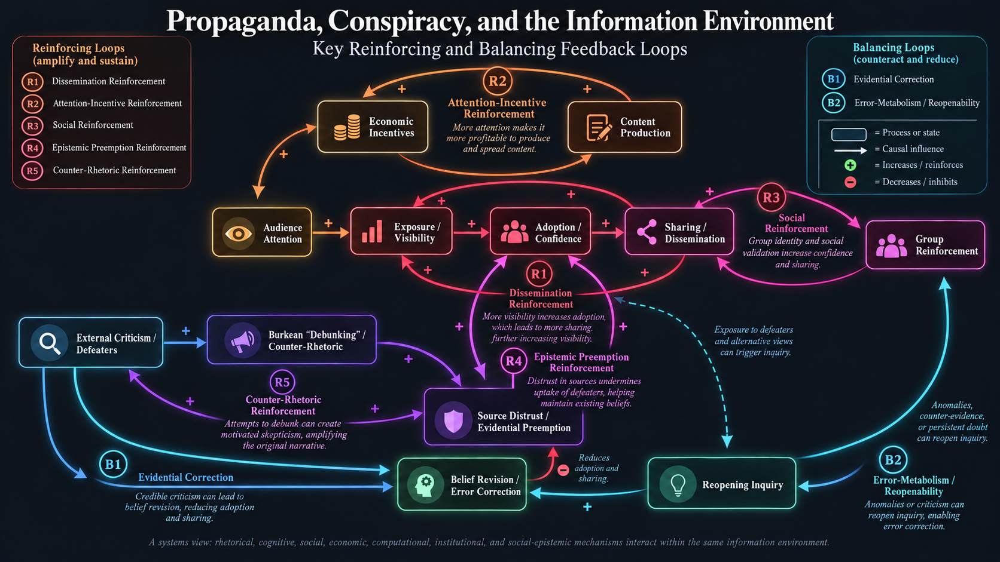

# Propaganda, Conspiracy, and the Information Environment: A Systems View

## Table of Contents

- [The System and the Views We Take of It](#the-system-and-the-views-we-take-of-it)
- [Why a Systems View? INUS Conditions and Causal Fields](#why-a-systems-view-inus-conditions-and-causal-fields)
- [An Epistemic Benchmark](#an-epistemic-benchmark)
- [An Epistemic Profile Rather Than a "Conspiracy Score"](#an-epistemic-profile-rather-than-a-conspiracy-score)
- [Definitions: What Exactly Are We Talking About?](#definitions-what-exactly-are-we-talking-about)
- [View 1: Argumentation Theory and Rhetoric](#view-1-argumentation-theory-and-rhetoric)
- [View 2: Cognitive Science and Psychology](#view-2-cognitive-science-and-psychology)
- [View 3: Social Structure, Identity, and Information Diffusion](#view-3-social-structure-identity-and-information-diffusion)
- [View 4: Economics and Incentives](#view-4-economics-and-incentives)
- [View 5: Media Theory and Computational Propaganda](#view-5-media-theory-and-computational-propaganda)
- [View 6: Institutions, Education, and Governance](#view-6-institutions-education-and-governance)
- [View 7: Trust, Testimony, and Social Epistemology](#view-7-trust-testimony-and-social-epistemology)
- [What Follows from a Systems Approach?](#what-follows-from-a-systems-approach)
- [Where the Series Goes from Here](#where-the-series-goes-from-here)
- [Working Bibliography](#working-bibliography)
  - [Additional Sources](#additional-sources)

I've been thinking about propaganda and conspiracy in relation to one another for quite some time. What interests me most is not a single mechanism that explains either phenomenon, but the way several mechanisms can coexist, interact, and sometimes amplify one another through feedback.

As an initial example, imagine a propaganda source disseminating a conspiratorial assertion. Some audience members accept or repeat it. Critics then introduce undermining evidence, [defeaters](https://en.wikipedia.org/wiki/Defeater), or rebuttals. Those criticisms may reduce confidence in the claim, but they may also be rhetorically reinterpreted. In Kenneth Burke's sense of the **debunking** method, a critic, institution, or source can itself become the object of a systematic "let down": its motives are redescribed, its credibility is attacked, and the criticism is absorbed into an adversarial interpretive frame. In a sufficiently insulated epistemic environment, criticism can even be taken as evidence that the alleged conspiracy is threatened by exposure. I will refer to one version of that move as **evidential preemption**: a social-epistemic strategy that supplies reasons in advance for discounting possible counterevidence or outside testimony.

This is not intended as *the* mechanism behind propaganda or conspiracy theories. It is an entry point into the kind of system I want to study. The same criticism may function as a genuine defeater for one audience, as irrelevant noise for another, and as material for further rhetorical reinforcement in a third. The outcome depends on the other mechanisms already operating in the system.

The signs on the arrows are causal-loop signs, not value judgments. A **+** means that, all else equal, movement in one variable tends to move the next in the same direction; a **-** means it tends to move it in the opposite direction. The diagram is deliberately schematic. It does not claim that every arrow is present, equally strong, or dominant in every context.

Several recognizable loops appear in the sketch:

| Loop | Type | Basic structure | What it highlights |
|---|---|---|---|
| **R1: Propagation** | Reinforcing | exposure → commitment → sharing → exposure | A message can create more opportunities for its own uptake as believers become disseminators. |
| **R2: Attention/incentive** | Reinforcing | exposure → engagement → production incentive → promotion → exposure | Economic and platform incentives can reward the production and amplification of attention-capturing material. |
| **R3: Social reinforcement** | Reinforcing | commitment → public expression → perceived group acceptance → commitment | Expressions of belief can alter perceived norms and credibility within a group. |
| **R4: Epistemic insulation** | Reinforcing | commitment → preemptive distrust → reduced uptake of defeaters → persistence of commitment | Trust can be reorganized so that outside correction loses epistemic force before it is considered. |
| **R5: Counter-rhetorical reinforcement** | Reinforcing | dissemination → criticism → counter-rhetoric → distrust → reduced uptake → continued commitment/dissemination | Where greater visibility attracts criticism, that criticism can be transformed into material for attacking the critic and sustaining the original commitment. |
| **B1: Evidential correction** | Balancing | dissemination → criticism/defeaters → evidential uptake → reduced confidence → reduced dissemination | Where dissemination generates corrective attention and the correction is actually taken up, propagation can dampen itself. |
| **B2: Error metabolism** | Balancing | commitment → specific expectations → anomalies → reopening inquiry → model revision → reduced commitment | Where a view makes sufficiently specific commitments, failed expectations can trigger procedures that discover and repair error rather than merely defend prior commitments. |

There are almost certainly additional loops: institutional moderation or friction, reputation effects, legal constraints, social sanctions, changes in platform design, and resource limitations could all create balancing or reinforcing processes. I am not trying to finish the model with this diagram. I want it to give the rest of the series a common object to investigate.

## The System and the Views We Take of It

The same system can be approached from several perspectives. I currently see at least seven useful views:

1. **Argumentation and rhetoric**: fallacies, dialogue rules, burdens of proof, argument schemes, persuasive tactics, framing, and rhetorical counteraction.
2. **Cognitive science and psychology**: attention, memory, motivated cognition, uncertainty, threat, heuristics, and the cognitive costs of inquiry.
3. **Social structure and networks**: identity, group norms, homophily, social learning, diffusion, network topology, and perceived consensus.
4. **Economics and incentives**: attention markets, advertising, monetization, creator incentives, funding, platform competition, and the costs of verification.
5. **Media theory and computational systems**: affordances, format, recommendation systems, ranking, metrics, algorithmic amplification, participatory disinformation, and distributed media ecosystems.
6. **Institutions and governance**: education, journalism, regulation, consumer protection, professional norms, transparency, and institutional credibility.
7. **Interpersonal psychology and social epistemology**: trust, testimony, expertise, echo chambers, hostile epistemic environments, source credibility, and evidential preemption.

These are not competing explanations. They are **views of the same system**. Each foregrounds different variables and causal relations while leaving others in the background.

| View | What it foregrounds | Typical links in the system |
|---|---|---|
| Argumentation / rhetoric | How claims are framed, defended, attacked, and insulated | message → acceptance; criticism → counter-rhetoric; burden shifting → persistence |
| Cognitive | How limited agents attend, interpret, remember, and update | exposure → attention; salience → acceptance; cognitive load → heuristic reliance |
| Social / network | How information and credibility move between people and groups | sharing → exposure; group acceptance → credibility; network position → reach |
| Economic | Why information is produced, packaged, and promoted | engagement → revenue/incentive; cost of verification → production choices |
| Media / computational | How communication infrastructures select and distribute information | engagement → ranking; ranking → exposure; format → communicability |
| Institutional | How rules, organizations, and public systems shape information quality and correction | governance → friction; education → evaluative capacity; institutional trust → uptake |
| Social epistemic | How agents decide whom to trust and what testimony can count as evidence | source credibility → uptake; preemption → distrust; expertise → deference |

This distinction is important. A cognitive account may explain why a message is appealing; an economic account may explain why someone produces it; a network account may explain why it spreads; a media account may explain why it is made unusually visible; and a social-epistemic account may explain why a correction fails. Those explanations can all be true of the same case.

## Why a Systems View? INUS Conditions and Causal Fields

None of the seven views is individually necessary or sufficient for the proliferation of conspiratorial or propagandistic information. Cognitive biases alone do not generate a propaganda campaign. An economic incentive alone does not determine which message will be believed. A network can enable rapid diffusion without determining whether the information is credible. Strong community norms can suppress a mechanism that is highly effective elsewhere.

One useful way to express this is J. L. Mackie's concept of an **INUS condition**: an *insufficient but necessary part of an unnecessary but sufficient set* of conditions. A factor we casually call "the cause" may be neither necessary nor sufficient by itself. Instead, it is one component of a configuration that is sufficient in a particular causal field, while some other configuration could have generated a similar outcome.

That language is useful here because it discourages monocausal explanation. The relevant question is not only whether a factor matters, but **what causal role it plays, in which configuration, at what stage, and under which background conditions**. This is also why causal importance can vary across cases. The same mechanism may dominate in one information environment and matter very little in another.

I will therefore treat propaganda and conspiratorial reasoning throughout this series as phenomena emerging from a broader information system: actors, messages, audiences, institutions, technologies, incentives, trust relations, and feedback processes interacting over time.

I will use a few causal distinctions throughout the series:

- **Production**: Why is a message created in this form?
- **Adoption**: Why does an individual or group come to accept or entertain it?
- **Diffusion**: Through what pathways does it travel?
- **Persistence**: Why does it survive criticism, contradiction, or failed expectations?
- **Amplification**: Why does it become disproportionately visible or salient?
- **Correction**: Under what conditions do defeaters, rival explanations, or institutional processes successfully reduce confidence or reach?

This lifecycle is not strictly linear. The stages feed back into one another. Diffusion changes incentives for production; adoption changes social norms; criticism changes trust; metrics change visibility; visibility changes perceived credibility; and correction can itself generate new rhetorical material. That recursive structure is precisely why a systems view is useful.

## An Epistemic Benchmark

Before trying to identify what is defective about a piece of conspiratorial or propagandistic reasoning, we need a benchmark for responsible inquiry. Otherwise terms such as *irrational*, *skeptical*, *biased*, or *unreasonable* can become little more than labels for conclusions we dislike.

I develop the benchmark I have in mind in [A Working "Theory" of Rationality](https://afontana1.github.io/critical-thinking-academy/philosophy/rationality-theory/blog.html). The basic proposal there is that rational inquiry is layered. It includes the structure and goal of the dialogue, comparison among rival explanatory models, interpretation and provenance of evidence, evidence-responsive belief updating, intellectual virtues, and the epistemic environment in which inquiry takes place. Rationality is therefore not exhausted by formal validity or by avoiding a list of named fallacies.

Throughout this series, I will return to several standards from that framework:

- **Dialogical appropriateness**: What kind of disagreement is this, what are the burdens of proof, and is the exchange structured so that criticism can actually matter?
- **Rival-model comparison**: Is the favored hypothesis being compared with the strongest serious alternatives, or merely defended one argument at a time?
- **Evidential relevance and structure**: Why should a datum count for or against the hypothesis, and what inferential chain connects it to the conclusion?
- **Provenance**: How was the evidence produced, selected, measured, filtered, or transmitted?
- **Evidence-responsive updating**: Do relevant defeaters change confidence when they should?
- **Epistemic virtue**: Are similar standards being applied to favored and disfavored claims? Are humility, conscientiousness, fairness, and open-mindedness functioning as real constraints?
- **Environmental awareness**: How are platforms, institutions, incentives, communities, and trust networks shaping the information available to the inquirer?
- **Reopenability and error metabolism**: What would cause a conclusion to be revisited, and does the system contain a mechanism for discovering and correcting its own errors?

These standards do not mechanically classify a belief as rational or irrational. They give us dimensions along which an inquiry can be examined.

## An Epistemic Profile Rather Than a "Conspiracy Score"

It is tempting to ask whether some conspiracy theories are more legitimate than others and then search for a single ranking mechanism. I think a better approach is **multidimensional**. I will therefore evaluate the object in terms of an epistemic profile rather than reducing it to a single score.

| Dimension | Question |
|---|---|
| **Background plausibility** | How well does the hypothesis fit independently established knowledge about the relevant actors, mechanisms, constraints, and context? |
| **Rival-model performance** | How well does it explain the evidence compared with the strongest serious alternatives? |
| **Evidential relevance** | Why should each cited observation count for or against the hypothesis? |
| **Evidential structure** | How do the pieces of evidence combine: independence, corroboration, dependence, conflict, or common sourcing? |
| **Provenance** | Where did the evidence come from, how was it gathered, and what selection or filtering processes shaped it? |
| **Source independence** | Do apparently convergent sources represent genuinely independent information pathways, or are they repeating the same upstream source? |
| **Evidential symmetry** | Are favorable and unfavorable considerations being judged by comparable standards? |
| **Defeater responsiveness** | Does relevant counterevidence appropriately reduce confidence, or is it ignored or redescribed without cost? |
| **Preemption** | Does the theory contain built-in reasons for dismissing broad classes of possible counterevidence or testimony in advance? |
| **Reopenability** | What conceivable observation, prediction failure, or argument would cause the inquiry to be reopened? |
| **Ad hoc complexity** | How much auxiliary machinery is being added primarily to protect the favored explanation from difficulty? |

I will not treat any single dimension as decisive. Scientific and historical explanations can legitimately be complex; genuine conspiracies can involve secrecy; testimony can be untrustworthy; and theories sometimes survive apparent counterevidence for good reasons. The point is comparative and procedural: **what explanatory and epistemic costs are being incurred, and are those costs acknowledged consistently?**

This is also where I want to resist treating "self-sealing" as an all-or-nothing property. There are stronger and weaker forms of evidential insulation, and the mere possibility of revising an auxiliary hypothesis does not uniquely distinguish conspiracy theories from other forms of theorizing. The interesting questions concern degree, practice, plausibility, and the costs imposed by the defensive move.

## Definitions: What Exactly Are We Talking About?

In the definitions essay, I will do more than simply supply dictionary definitions. I want to establish several distinctions that will matter throughout the series, especially because *propaganda*, *conspiracy*, and *conspiracy theory* are often used as evaluative labels rather than descriptive categories.

I will begin by separating:

- an **actual conspiracy**: covert coordination among multiple actors toward some end;
- a **conspiracy hypothesis or theory**: an explanatory claim that posits such coordination;
- **conspiratorial or conspiracist reasoning**: characteristic ways of constructing, defending, or insulating conspiracy explanations.

The first two are not inherently irrational. Real conspiracies occur, and it can be reasonable to investigate a conspiracy hypothesis. The more difficult question is what distinguishes responsible investigation of covert coordination from an epistemically defective mode of inquiry.

This is where the rationality framework becomes useful. The relevant pathology may not be the presence of conspiracy in the content of a hypothesis, but the way the hypothesis is generated, compared with alternatives, supported by evidence, protected from criticism, or embedded in a trust network.

The same care is needed with **propaganda**. A useful definition will have to distinguish propaganda from persuasion generally, and likely from misinformation and disinformation. Questions of truth or falsity alone will not be enough: propaganda can contain true claims, and a false statement need not be propaganda. Intent, strategic selection, framing, repetition, audience design, institutional context, and the management of attention or identification may all matter.

### Questions we will develop in the definitions essay

- What properties are genuinely definitional, and which are merely common features?
- Should *conspiracy theory* be a neutral descriptive term, a pejorative term, or a family-resemblance category?
- Can a conspiracy hypothesis be well supported while still containing some defective reasoning, or poorly supported while investigated responsibly?
- How should background plausibility enter the evaluation?
- When does ordinary skepticism become skeptical dogmatism?
- What is the difference between legitimate protection of a hypothesis with auxiliary assumptions and ad hoc immunization from counterevidence?
- What are **misinformation**, **disinformation**, and **malinformation** and where are these distinctions useful?
- What is the difference between **skepticism** and motivated or selective skepticism?
- What are **echo chambers** and **epistemic bubbles**?
- How is **epistemic insulation / self-sealing** and **evidential preemption** functionally important?

## View 1: Argumentation Theory and Rhetoric

> Argumentation theory explains the local structure of epistemic exchange: how claims acquire support, how criticism is supposed to function, and how reasoning can become insulated from defeat. Rhetoric explains how those exchanges are strategically framed and symbolically organized. In the broader system, these mechanisms help determine whether a piece of counterevidence becomes a successful defeater, a rejected source, or raw material for further reinforcement.

The argumentation view asks what happens *inside the exchange of reasons*. Conspiratorial and propagandistic communication does not consist only of propositions that are true or false; it also involves burdens of proof, dialogue types, argument schemes, framing, audience adaptation, strategic ambiguity, and efforts to define which criticisms are admissible.

We will connect classical rhetoric with contemporary argumentation theory. One organizing question will be whether an argumentative move helps a critical discussion do its epistemic job or instead blocks the procedures by which claims can be challenged and revised. This lets us treat fallacies as more than a checklist of invalid forms. Burden shifting, selective standards, straw men, ambiguity, Gish gallops, whataboutism, and source attacks can function as **dialogical obstructions** even when individual statements are not formally invalid.

Burke's concept of debunking belongs here. I am using *debunking* in Burke's rhetorical sense rather than the contemporary sense of fact-checking. The interest is in a strategy of deflation or "let down": exposing or redescribing the supposedly elevated motives, ideals, authorities, or appearances that sustain an opponent's position. In the present system, that method can interact with social epistemology when rhetorical attacks on a critic become reasons to discount the critic's testimony.

### Questions we will address

- Which argument schemes recur in conspiratorial reasoning, and what critical questions should govern their evaluation?
- What distinguishes responsible defeasible reasoning from epistemically self-sealing argumentation?
- How do dialogue types, rhetorical goals, and dialectical obligations change the meaning of skepticism and criticism?
- When do arguments from ignorance become reasonable, particularly when relevant evidence may be hidden, destroyed, or inaccessible?
- How do burden shifting and uneven standards allow claims to persist without gaining positive support?
- When is criticism of a source a legitimate undercutting defeater, and when does it become a genetic fallacy or evidential preemption?
- How do ambiguity, framing, straw men, Gish gallops, whataboutism, and other rhetorical moves alter how a defeater is received?
- How does Burkean debunking differ from contemporary fact-checking, and when can rhetorical deflation fuel a reinforcing loop?
- Can recurring dialectical failures be identified without defining all conspiracy theories as irrational in advance?
- How do persuasion, identification, and symbolic action interact with truth-tracking?

### Concepts and mechanisms

- **Defeasible argumentation:** Many reasonable everyday arguments are open to revision rather than deductively conclusive. Rebutting and undercutting defeaters, exceptions, presumptions, standards of proof, and the critical questions attached to argumentation schemes provide a more useful vocabulary than a simple valid/invalid distinction. Walton's work offers a starting point.
- **Dialogue types and dialectical obligations:** Persuasion, inquiry, negotiation, deliberation, and eristic conflict have different goals and norms. A discussion can go wrong when participants appear to be in a common inquiry but treat criticism as different kinds of acts—for example, as a request for clarification or as a hostile maneuver.
- **Burdens of proof and arguments from ignorance:** The absence of evidence has different significance depending on whether evidence should exist, how thoroughly it has been sought, who can access it, and whether the claim concerns hidden activity. We need to distinguish a justified inference from absence from the illicit move from “not disproved” to “confirmed.”
- **Defeaters and evidential preemption:** A defeater should be able to change a belief's justificatory status. A blanket rule such as “anyone who supplies contrary evidence is compromised” instead changes the admissibility of criticism before its content is examined. This is the bridge from argumentation theory to social epistemology.
- **Generalism and particularism:** Philosophers disagree about whether conspiracy theories are epistemically suspect as a class or must be assessed case by case. Keeley, Dentith, and more recent qualifications of the debate help avoid defining irrationality into the category itself.
- **Burkean debunking and counter-rhetoric:** Here, *debunking* means Burke's rhetorical deflation or “let down,” not modern factual correction. The mechanism of interest is **criticism → rhetorical counteraction → attack on the critic's sources or standing → reduced uptake of criticism → continued commitment or dissemination**. This is a conditional feedback claim, not an assertion that criticism invariably strengthens belief.

The larger inquiry should examine when source-based disagreement is appropriate, when it substitutes for evaluating the proposition, and how the same evidence can be organized into rival narratives.

### Scope and limits

**What this view helps explain:** why some arguments feel persuasive despite weak evidential support; how burdens of proof shift; how ambiguous evidence gets rhetorically organized; how source criticism becomes a substitute for proposition-level engagement; how a claim becomes difficult to defeat; how the same evidence can be framed differently by rival narratives; how inquiry can become adversarial or strategically closed.

**What it does not explain on its own:** argumentation theory alone does not explain why certain people are motivated to accept one argument, why one message reaches millions, why platforms reward some rhetorical styles, why social identity changes source credibility, or why a producer has an economic incentive to make a claim.

### References

- [Douglas Walton — *Fundamentals of Critical Argumentation*](https://www.cambridge.org/core/books/fundamentals-of-critical-argumentation/D85729AD5CAEEDF179C6A9A363E45088)
- [Douglas Walton — *Methods of Argumentation*, Chapter 2](https://www.cambridge.org/core/books/abs/methods-of-argumentation/argument-attack-rebuttal-refutation-and-defeat/902DB43C8DF608218A1C8A66CF55F3BB)
- [Douglas Walton — "Nonfallacious Arguments from Ignorance"](https://www.researchgate.net/publication/246966632_Nonfallacious_arguments_from_ignorance)
- [Brian L. Keeley — "Of Conspiracy Theories" (1999)](https://zalkind.info/s/Of-Conspiracy-Theories.pdf)
- [M. R. X. Dentith — *The Philosophy of Conspiracy Theories* (2014)](https://link.springer.com/book/10.1057/9781137363169)
- [Romy Jaster & Geert Keil — "Defining 'Conspiracy Theory' Without Begging the Question: A Roadmap" (2026)](https://link.springer.com/article/10.1007/s10670-025-01040-5)
- [Ann George — *Kenneth Burke's Permanence and Change: A Critical Companion* (2018)](https://www.jstor.org/stable/j.ctv6mtf3b)
- [Debra Hawhee — "Propaganda Among the Ruins"](https://academic.oup.com/edited-volume/28010/chapter-abstract/211790477)
- [M. R. X. Dentith (ed.), *The Philosophy of Conspiracy Theories: Concepts, Methods and Theory*](https://www.routledge.com/The-Philosophy-of-Conspiracy-Theories-Concepts-Methods-and-Theory/Dentith/p/book/9781032711409)
- ["Suspicious conspiracy theories," *Synthese*](https://link.springer.com/article/10.1007/s11229-022-03602-4)
- ["Some problems with particularism."](https://pmc.ncbi.nlm.nih.gov/articles/PMC9617528/)
- Jason Stanley, *How Propaganda Works*.
- Jonathan Auerbach & Russ Castronovo (eds.), *The Oxford Handbook of Propaganda Studies*.
- Kenneth Burke, [*Permanence and Change: An Anatomy of Purpose*](https://www.ucpress.edu/books/permanence-and-change/paper).
- Frans H. van Eemeren and Rob Grootendorst, work on pragma-dialectics and critical discussion.
- Argumentation and evidence-analysis sources collected in [*A Working “Theory” of Rationality*](https://afontana1.github.io/critical-thinking-academy/philosophy/rationality-theory/blog.html).

## View 2: Cognitive Science and Psychology

> The cognitive view explains how finite agents allocate attention, interpret evidence, form confidence, and respond to uncertainty. Its mechanisms are necessary for understanding uptake, but they are not free-floating defects inside individuals. They are activated, constrained, and exploited by social relations, network structures, rhetorical forms, economic incentives, and media systems.

The cognitive view asks how finite agents process messages under conditions of uncertainty, limited attention, incomplete information, and motivational pressure. The important point is not that "bias causes conspiracy." Biases are ubiquitous. The question is how cognitive mechanisms interact with particular messages and environments so that some claims are more memorable, intuitively satisfying, threatening, identity-congruent, or cognitively inexpensive than their competitors.

Here, we will distinguish several mechanisms that are often collapsed together: limits on attention and working memory, pattern perception, proportionality intuitions, uncertainty reduction, need for control, motivated reasoning, repetition and familiarity, emotional salience, and the appeal of explanatory closure. We will also distinguish *believing* a claim from *sharing* it; the mechanisms producing those behaviors need not be identical.

### Questions we will address

- Which mechanisms contribute to accepting a claim, and which contribute instead to sharing it?
- How do epistemic, existential, and social motives interact with uncertainty, threat, control, and explanatory closure?
- When does analytic thinking improve belief calibration, and when is it recruited to defend prior commitments?
- How should analytic thinking, critical thinking, scientific reasoning, cognitive reflection, and open-mindedness be distinguished?
- How do repeated exposure, familiarity, narrative coherence, and perceived source credibility interact?
- How do novelty, surprise, fear, disgust, moral emotion, and other attention-capturing features affect uptake and sharing?
- Does cognitive scarcity or information overload increase reliance on particular heuristics or rhetorical forms?
- Under what conditions do agency detection and proportionality intuitions miscalibrate causal explanation?
- What cognitive processes enable someone to reopen an inquiry and revise a favored explanation?

### Concepts and mechanisms

- **Epistemic, existential, and social motives:** Douglas, Sutton, and Cichocka distinguish the desire to understand and reduce uncertainty, the desire for control and security, and the desire to protect a positive individual or group image. These motives may increase a claim's appeal, but that does not show that believing it actually satisfies them.
- **Analytic and intuitive processing:** Research links analytic thinking with lower endorsement of some conspiracy claims or misinformation, but analytic thinking is not synonymous with intelligence, critical thinking, scientific reasoning, or actively open-minded thinking. Processing style, prior commitments, expertise, and environment interact.
- **Uncertainty and need for closure:** Ambiguity and lack of control may increase demand for explanations. The important distinctions include situational versus chronic uncertainty, whether a proposed account genuinely resolves it, and whether the account generates further distrust.
- **Agency detection and intentionality:** A tendency to perceive deliberate agency may favor conspiratorial explanations in some circumstances. Because covert coordination is real, the relevant standard is the calibration of an intentional explanation against the evidence and alternatives, not whether it invokes hidden actors.
- **Proportionality intuitions:** People may find a large cause more fitting for a consequential event. Proportionality bias can make sweeping stories satisfying, but the magnitude of an event does not itself rule out large-scale causation; we need to examine the inference.
- **Attention versus accuracy:** Believing and sharing are not equivalent. A person may value accuracy while sharing material for novelty, identity expression, emotion, or reward. The system should therefore not use **sharing = belief** as a background assumption.
- **Repetition and familiarity:** Repeated exposure may increase familiarity and perceived truth under some conditions. A useful cross-level pathway is **network repetition → familiarity → changed cognitive processing**, with source credibility as an important modifier.
- **Cognitive scarcity and metacognition:** Limited attention, working memory, or time can make heuristics and trusted proxies more influential. The research question is which shortcuts are useful in an environment, when they are exploitable, and what supports renewed scrutiny.

**Methodological caution:** A false claim, an irrationally held claim, and a claim held under different background assumptions or trust relationships are not the same thing. An explanation in terms of cognitive bias is circular if irrationality is inferred merely from disagreement with the researcher. Additional topics include confirmation bias, motivated reasoning, confabulation, conjunction errors, memory, moral outrage, and actively open-minded thinking.

### Scope and limits

**What this view helps explain:** susceptibility under uncertainty; why explanatory closure can be attractive; differences between intuitive and reflective processing; why attention and belief diverge; how cognitive scarcity changes evaluation; why repetition matters; how motivational states affect interpretation.

**What it does not explain on its own:** it does not by itself explain which messages become available, who creates them, which networks carry them, how identity is institutionally organized, how monetization affects supply, or how source trust is socially produced.

### References

- [Douglas, Sutton & Cichocka — "The Psychology of Conspiracy Theories" (2017)](https://journals.sagepub.com/doi/full/10.1177/0963721417718261)
- [van Prooijen & Douglas — "Belief in conspiracy theories: Basic principles of an emerging research domain"](https://pmc.ncbi.nlm.nih.gov/articles/PMC6282974/)
- [Swami et al. — "Analytic thinking reduces belief in conspiracy theories" (2014)](https://www.sciencedirect.com/science/article/pii/S0010027714001632)
- ["Conspiratorial Beliefs and Cognitive Styles" (2021)](https://pmc.ncbi.nlm.nih.gov/articles/PMC8545864/)
- [Pennycook et al. — "Shifting attention to accuracy can reduce misinformation online" (2021)](https://www.nature.com/articles/s41586-021-03344-2)
- [Pennycook & Rand — accuracy-prompt meta-analysis (2022)](https://www.nature.com/articles/s41467-022-30073-5)
- [van der Linden — "Misinformation: susceptibility, spread, and interventions to immunize the public" (2022)](https://www.nature.com/articles/s41591-022-01713-6)
- [Douglas — "Antecedents and consequences of science-related conspiracy beliefs" (2026)](https://www.sciencedirect.com/science/article/pii/S2352250X25002040)

## View 3: Social Structure, Identity, and Information Diffusion

> The network view explains how local relational structure changes exposure, repetition, reinforcement, and diffusion. It replaces the image of isolated believers with agents embedded in networks whose topology affects which information is available, which signals appear independent, and which beliefs become socially normal. The network does not replace cognition or trust; it structures the environment in which they operate.

The network view changes the unit of analysis. Instead of asking only why an individual accepts a claim, it asks how claims move through a population and how network structure changes what people encounter, whom they observe, and which beliefs appear socially validated.

Information diffusion is not neutral transport. Homophily, clustering, bridge nodes, influencers, repeated exposure, community boundaries, and social learning can alter both reach and perceived credibility. Identity can make certain messages more communicable because sharing them performs social work: signaling group membership, loyalty, grievance, status, or opposition.

This is also where the concept of **communicability** becomes important. Some messages are better adapted to particular media and network structures than others. A short emotionally vivid claim may travel differently from a long evidential reconstruction. "Fitness" in an information ecosystem therefore does not imply truth; it can mean compatibility with the selection pressures imposed by attention, format, network structure, and audience incentives.

### Questions we will address

- Under what conditions do claims and commitments behave like simple versus complex contagions?
- How do clustering, homophily, bridges, influencers, and network boundaries accelerate or inhibit diffusion?
- When does repeated exposure produce social reinforcement rather than genuine independent corroboration?
- How can we distinguish persuasion from preexisting similarity among connected people?
- How do social identity, public expression, and perceived group consensus change credibility and interpretation?
- Which features make a message easy to reproduce, compress, remix, or transmit across networks and media?
- Do tightly clustered communities slow spread between groups while strengthening local reinforcement?
- What changes when communities migrate across platforms or encounter moderation?
- How should epistemic bubbles and echo chambers be operationalized rather than treated as one phenomenon?

### Concepts and mechanisms

- **Diffusion:** Information, innovations, behaviors, and commitments move through populations by different pathways. A trivial claim may spread after one exposure, whereas an identity-relevant or costly commitment may require repeated social confirmation.
- **Simple and complex contagion:** Centola and Macy's account of complex contagion is useful when multiple reinforcing social contacts influence adoption. The relevant question becomes not only whether a person encountered a claim but how many socially meaningful confirmations they saw and from whom.
- **Homophily:** Similar people often form ties with one another. Observed similarity between connected individuals can therefore reflect prior selection into a network, persuasion within it, or both. Distinguishing these processes is a major causal-identification challenge.
- **Echo chambers, clustering, and polarization:** Selective exposure, homogeneity, repetition, discrediting outsiders, algorithmic personalization, and identity sorting are distinct mechanisms. They can combine, but they should not be collapsed into an undifferentiated “echo chamber” effect.
- **Social identity:** Group membership and its associated status, belonging, and security can shape what people share and find credible. One potential loop is **identity-congruent message → group validation → confidence → public expression → perceived consensus**.
- **Novelty and diffusion:** Vosoughi, Roy, and Aral found that verified false news in a particular Twitter dataset spread farther, faster, more deeply, and more broadly than verified true news. Novelty is one possible contributor; the finding is not a universal law that falsehood always spreads faster.
- **Network composition and reinforcement:** A 2026 study of Polish political accounts on X reported that the proportion of conspiracy-sharing neighbors predicted transmission better than their absolute number. This illustrates why the relational composition of one's environment can matter beyond individual exposure counts.
- **Communicability:** A message's fitness for a network depends partly on brevity, emotional vividness, ease of copying, and compatibility with format and incentives. Success in diffusion does not by itself imply truth.

### Scope and limits

**What this view helps explain:** why repeated social confirmation matters; why identical messages have different effects in different communities; why network position changes diffusion; how local consensus can emerge; how identity and relational structure reinforce one another; how network composition affects what evidence is encountered.

**What it does not explain on its own:** network structure does not by itself explain why content is compelling, why a person trusts a source, why the content was produced, why a platform ranked it, whether the underlying argument is good, or what institutions regulate the network.

### References

- [Centola & Macy — "Complex Contagions and the Weakness of Long Ties" (2007)](https://www.journals.uchicago.edu/doi/abs/10.1086/521848)
- [Damon Centola — "The Spread of Behavior in an Online Social Network Experiment" (2010)](https://pubmed.ncbi.nlm.nih.gov/20813952/)
- [Del Vicario et al. — "The spreading of misinformation online" (2016)](https://doi.org/10.1073/pnas.1517441113)
- [Vosoughi, Roy & Aral — "The spread of true and false news online" (2018)](https://pubmed.ncbi.nlm.nih.gov/29590045/)
- [Robertson et al. — "How social identity shapes conspiratorial belief" (2022)](https://www.sciencedirect.com/science/article/pii/S2352250X22001440)
- [Cinelli et al. — "Conspiracy theories and social media platforms" (2022)](https://www.sciencedirect.com/science/article/pii/S2352250X22001282)
- [Matuszewski & Rams-Ługowski — "Social influence and network structure: How conspiracy theories spread on social media" (2026)](https://www.sciencedirect.com/science/article/pii/S0049089X25001437)
- [Gkinopoulos, Kossowska & Walther — "A community of unknowledge" (2026)](https://www.sciencedirect.com/science/article/pii/S2352250X25002064)
- Everett Rogers, *Diffusion of Innovations*.
- Mark Granovetter, "The Strength of Weak Ties."
- Thomas Schelling, *Micromotives and Macrobehavior*.
- Duncan Watts, network cascade literature.
- Matthew Jackson, social and economic network theory.
- Kate Starbird and collaborators, research on alternative-media ecosystems and participatory information operations.

## View 4: Economics and Incentives

> The economic view explains why information environments systematically produce some messages more readily than others. Attention, verification, monetization, and platform competition create selection pressures on content. These incentives do not determine belief, but they shape the supply, form, frequency, and visibility of the claims that cognitive and social mechanisms later process.

The economic view asks why certain information is worth producing and distributing. Modern information environments contain markets for attention, advertising, subscriptions, donations, influence, reputation, and political or organizational advantage. These incentives do not determine content by themselves, but they shape which forms of content are cheap to produce, profitable to repeat, costly to verify, or attractive to amplify.

We will examine both **supply** and **demand**. Producers face incentives to create content; platforms face incentives to retain users and sell access to attention; advertisers and funders supply revenue; audiences spend scarce time and attention; and verification itself has a cost. I am interested in how these pressures interact with psychological and social mechanisms rather than replacing them.

### Questions we will address

- Whose incentives are being analyzed: creators, platforms, advertisers, funders, subscribers, users, or intermediaries?
- When does attention become economically valuable, and how do monetary and social rewards interact?
- How do advertising, subscriptions, donations, and creator monetization change the production and distribution of content?
- Do these models favor falsehood specifically, or content optimized for attention at the expense of nuance and completeness?
- What are the relative costs of producing, checking, correcting, and consuming a claim, and who bears them?
- How do verification incentives, certification, filtering, and content lifespan affect the spread of low-quality material?
- How do market concentration, platform competition, and engagement-driven ranking create externalities?
- Which financial networks and intermediaries support campaigns that appear grassroots?
- How do platform business models interact with cognition, group status, and information diversity?

### Concepts and mechanisms

- **Attention as a scarce resource:** Information may be abundant while human attention remains limited. Producers therefore face pressure to optimize what is noticed, clicked, retained, shared, or subscribed to—not just what is accurate. That pressure can shape form and timing even without deliberate fabrication.
- **Attention versus information quality:** Serra-Garcia's work suggests that incentives for attention can change how much information communicators convey, including through selection and omission, without necessarily making individual statements less factually accurate. The effect on downstream beliefs is more nuanced than “attention causes lies.”
- **Supply-side misinformation:** The relevant question is not only why people believe low-quality claims but who creates, funds, distributes, and monetizes them. Ahmad and collaborators examine how advertising systems can provide financing to misinformation-producing outlets.
- **Verification costs:** Producing and passing along a claim can be easier than checking it. Economic models can specify who verifies, when platforms filter or certify, and how costs and incentives shape the volume and lifespan of misinformation.
- **Social rewards:** Likes, status, follower growth, belonging, and visibility can be incentives even without money. Research by Globig, Holtz, and Sharot connects reward design to whether sharing becomes more discriminating about accuracy.
- **Platform business models and externalities:** It is too strong to assume that platforms always maximize misinformation. A sharper question is which ranking and revenue rules make individually profitable attention diverge from collectively valuable information quality.
- **Markets, intermediaries, and actor objectives:** Creators, publishers, ad networks, advertisers, platforms, influencers, payment processors, recommendation systems, and subscribers may optimize different outcomes. Explanation improves when the actor and its actual objective are made explicit.

Adjacent economic literatures include media bias, two-sided markets, rational inattention, information acquisition, signaling, reputation, principal–agent problems, and creator-economy markets.

### Scope and limits

**What this view helps explain:** why attention-grabbing content may be overproduced; why cheap verification can matter; how platform incentives influence ranking; why sensationalism can persist without ideological commitment; how advertisers and intermediaries finance content ecosystems; how social rewards affect sharing decisions.

**What it does not explain on its own:** it does not by itself establish whether an argument is epistemically justified, how trust is formed, why identity makes one source credible, why a narrative satisfies psychological needs, or how a network distributes exposure.

### References

- [Allcott & Gentzkow — "Social Media and Fake News in the 2016 Election" (2017)](https://www.aeaweb.org/articles?id=10.1257/jep.31.2.211)
- [Ahmad, Sen, Eesley & Brynjolfsson — "The Role of Advertisers and Platforms in Monetizing Misinformation" (2024)](https://www.nber.org/papers/w32187)
- [Globig, Holtz & Sharot — "Changing the incentive structure of social media platforms to halt the spread of misinformation" (2023)](https://elifesciences.org/articles/85767)
- [Cisternas & Vásquez — "Misinformation in Social Media: The Role of Verification Incentives" (revised 2026)](https://www.newyorkfed.org/research/staff_reports/sr1028)
- [Serra-Garcia — "The Attention-Information Trade-Off" (2026)](https://www.aeaweb.org/articles?id=10.1257/aer.20240850)
- [Chen — "A Model of the Attention Economy: Data, Platforms, and Discovery"](https://www.aeaweb.org/articles?from=f&id=10.1257/aer.20240651)
- ["Ranking for engagement: How social media algorithms fuel misinformation and polarization" (2026)](https://www.sciencedirect.com/science/article/pii/S0047272726000253)
- [Guy Aridor, Rafael Jiménez-Durán, Ro'ee Levy, and Lena Song, “The Economics of Social Media” (2024)](https://www.aeaweb.org/articles?id=10.1257%2Fjel.20241743).
- [Wajeeha Ahmad et al., “Companies inadvertently fund online misinformation despite consumer backlash” (2024)](https://www.nature.com/articles/s41586-024-07404-1).

## View 5: Media Theory and Computational Propaganda

> The media view explains the selection environment in which claims become visible and meaningful. Classical gatekeeping, agenda setting, and framing remain relevant, but contemporary communication is distributed across platforms, users, creators, ranking systems, automated agents, and moderators. The result is not a simple broadcast model but a recursive socio-technical system in which attention and visibility continuously feed back into future selection.

The media view examines the infrastructure through which messages become visible and meaningful. We no longer inhabit a simple centralized model in which a small number of broadcasters send finished messages to passive audiences. Communication is distributed across platforms, creators, users, recommendation systems, reposting networks, private groups, search systems, and traditional media that increasingly react to one another.

This matters because the medium is not merely a pipe. Formats impose constraints; metrics provide feedback; recommendation systems rank; interfaces make some actions easier than others; and audiences participate in the production, reinterpretation, and circulation of narratives. A strategic information operation may therefore be partly centralized and partly emergent.

This is where I want to examine **participatory disinformation**: the possibility that ordinary users, influencers, media organizations, activists, and strategic actors can collaboratively produce and amplify an information campaign without every participant sharing the same intention or even knowing they are part of a larger process.

### Questions we will address

- How do medium-specific affordances shape the forms of persuasion that can circulate successfully?
- How do classical agenda-setting, framing, gatekeeping, and media-selection ideas change in a distributed platform environment?
- Who or what performs gatekeeping when users, journalists, creators, and ranking systems jointly select visibility?
- How do engagement metrics become editorial signals in feedback loops between behavior and ranking?
- What would count as causal evidence of algorithmic amplification rather than a simple correlation with popularity?
- How do participatory narratives differ from centrally organized propaganda campaigns?
- How do coordinated behavior, automation, targeting, and algorithm gaming interact with ordinary participation?
- What does platform moderation change about visibility, monetization, network topology, and cross-platform migration?
- Why might the same claim be communicable in a short video, a documentary, a private group, or a search result in different ways?

### Concepts and mechanisms

- **Agenda setting:** McCombs and Shaw's idea of issue salience remains useful, but selection now happens through journalists, creators, users, platforms, recommendation systems, and feedback—not only editorial desks.
- **Framing:** Entman's framework distinguishes issue selection, problem definition, causal interpretation, moral evaluation, and proposed remedy. A narrative can transform the significance of real facts without inventing them.
- **Recursive media selection:** Luhmann's account emphasizes media as a system that recursively selects what counts as information. Recommendation systems are not equivalent to Luhmann's mass-media system, but their feedback-dependent selection rules are important to the same systems question.
- **Computational propaganda:** Woolley and Howard's approach directs attention to automation, bots, coordinated behavior, manufactured consensus, algorithm gaming, and data-driven targeting as means of shaping public opinion.
- **Participatory disinformation:** Starbird and colleagues show how ordinary users can remix, extend, interpret, and stabilize narratives associated with strategic information operations. Participation can be distributed even if some parts of an operation are planned.
- **Moderation as governance:** Following Gillespie, rules about removal, discoverability, account status, monetization, appeals, and cross-platform migration help constitute the platform, rather than merely policing an otherwise neutral channel.
- **Algorithmic amplification:** A more precise model than “the algorithm caused it” is **user behavior → engagement signals → ranking → visibility → further user behavior**. Measuring the strength and direction of these effects requires causal care.
- **Medium-specific communicability:** Duration, visuality, remixability, sharing friction, comment design, creator incentives, audience segmentation, and persistence/searchability can all change whether and how a message travels. The contrast between a TikTok clip and a documentary is one example.

Adjacent reading should also cover platformization, recommender systems, virality, creator cultures, and the “firehose of falsehood” as one propaganda model rather than a theory of all propaganda.

### Scope and limits

**What this view helps explain:** how salience is constructed; how frames select meaning; how algorithms and users create feedback; why the same claim behaves differently across media; how distributed participants contribute to propaganda; how moderation reshapes visibility and migration.

**What it does not explain on its own:** it does not independently explain why a person believes a claim, whether the evidence is good, how trust is justified, why production is profitable, or how institutions should govern speech.

### References

- [McCombs & Shaw — "The Agenda-Setting Function of Mass Media" (1972)](https://academic.oup.com/poq/article-abstract/36/2/176/1853310)
- [Robert Entman — "Framing: Toward Clarification of a Fractured Paradigm" (1993)](https://academic.oup.com/joc/article-abstract/43/4/51/4160153)
- [Niklas Luhmann — *The Reality of the Mass Media*](https://www.degruyter.com/document/doi/10.1515/9781503619227/html)
- [Woolley & Howard (eds.) — *Computational Propaganda* (2018)](https://www.oii.ox.ac.uk/research/publications/computational-propaganda-political-parties-politicians-and-political-manipulation-on-social-media-2/)
- [Starbird, Arif & Wilson — "Disinformation as Collaborative Work" (2019)](https://faculty.washington.edu/kstarbi/Disinformation-as-Collaborative-Work-Authors-Version.pdf)
- [Tarleton Gillespie — *Custodians of the Internet* (2018)](https://www.microsoft.com/en-us/research/publication/custodians-of-the-internet-platforms-content-moderation-and-the-hidden-decisions-that-shape-social-media/)
- [Cinelli et al. — "Conspiracy theories and social media platforms" (2022)](https://www.sciencedirect.com/science/article/pii/S2352250X22001282)
- [Lazer et al. — "The Science of Fake News" (2018)](https://www.hks.harvard.edu/publications/science-fake-news)
- [Kate Starbird's publication list:](https://faculty.washington.edu/kstarbi/publications.html)
- [Oxford Internet Institute Computational Propaganda project:](https://www.oii.ox.ac.uk/research/projects/computational-propaganda/)
- Research on platformization, recommender systems, content moderation, virality, and creator cultures.
- Research on the "firehose of falsehood" as one propaganda model rather than a general theory of all propaganda.
- [Killian McLoughlin and William Brady, “Human-algorithm interactions help explain the spread of misinformation” (2024)](https://pubmed.ncbi.nlm.nih.gov/38128169/).
- [Joseph Bak-Coleman et al., “Stewardship of global collective behavior” (2021)](https://pmc.ncbi.nlm.nih.gov/articles/PMC8271675/).

## View 6: Institutions, Education, and Governance

> The institutional view asks whether the information environment has mechanisms for detecting, correcting, and learning from error. Education, journalism, science, platforms, and governance structures all contribute to this capacity. Their success is not reducible to individual rationality: institutional credibility, transparency, incentives, due process, and network structure determine whether corrective mechanisms actually function.

The institutional view asks what organized systems do with information problems that individuals cannot solve alone. Education systems teach—or fail to teach—reasoning and information evaluation. Journalism develops professional procedures for verification. Scientific communities distribute expertise and error correction. Governments regulate markets and communication infrastructures. Platforms establish rules for moderation and recommendation. Consumer-protection systems address deception and asymmetric information.

The difficult question is not simply whether institutions should intervene. Institutions are themselves actors inside the system. They have incentives, legitimacy constraints, error rates, limited information, procedural obligations, and trust relationships with the public. An intervention can therefore change not only the immediate information flow but also the credibility of the institution imposing it.

### Questions we will address

- Which epistemic tasks do institutions perform that isolated individuals cannot carry out efficiently?
- What institutional properties support error detection, correction, learning, and long-term resilience?
- What should interventions optimize: accuracy, autonomy, exposure diversity, harm reduction, trust, or some combination?
- Can education and media literacy improve discernment without producing indiscriminate skepticism, and do gains transfer across topics and time?
- How should we distinguish moderation, friction, correction, censorship, and governance?
- How do transparency, audits, data access, researcher access, appeals, and due process affect institutional accountability?
- When do fact-checking, prebunking, inoculation, or combinations of interventions work, and how durable are their effects?
- How do institutional mistakes, legitimacy constraints, and perceived motives feed back into public trust?
- Who should carry responsibility for correction, and what makes institutions credible to people outside them?
- How can platform effects be evaluated when independent access to relevant data is limited?

### Concepts and mechanisms

- **Correction versus institutional resilience:** Responding to a single false claim is not the same as building a system that can learn from error. Provenance, auditability, independent review, correction processes, procedures for expert disagreement, data access, and incentives to acknowledge mistakes all contribute to **error metabolism**.
- **Media and information literacy:** Source evaluation, lateral reading, verification, argument evaluation, digital literacy, and recognition of misinformation can be taught. Reviews often find improvements in knowledge and discernment, while changes in actual behavior can be smaller or more variable: **better classification ≠ automatic behavior change**.
- **Fact-checking and the continued influence effect:** Corrections can reduce false beliefs while leaving residual effects on reasoning. Their impact can depend on timing, credibility, repetition, worldview congruence, and whether they provide a coherent alternative explanation.
- **Prebunking and inoculation:** Interventions before exposure raise questions about who administers them, their legitimacy and scale, durability, transfer between domains, and whether they unintentionally induce generalized skepticism.
- **Platform governance:** Platforms establish rules for allowable content, ranking, moderation, demonetization, accounts, appeals, transparency, and researcher access. They are simultaneously media infrastructures and governance institutions.
- **Data access and accountability:** A lack of platform data constrains independent evaluation. One possible pathway is **data access → auditability → evidence about effects → governance capacity**, conditioned by the quality of access and oversight.
- **Journalism as an epistemic institution:** Verification norms, correction policies, source independence, editorial judgment, declining local-news resources, professional trust, false balance, and speed pressure shape how journalism performs public knowledge functions.
- **Education system design:** Instruction should ask not only whether students can recall content but whether they can evaluate sources, use lateral reading, understand expert consensus, distinguish skepticism from distrust, and interpret recommendation and advertising systems.
- **Intervention taxonomy:** Later work should distinguish individual cognitive interventions (accuracy prompts and inoculation), educational interventions (media literacy), network measures (sharing friction and virality limits), economic measures (demonetization), platform design (ranking and labels), institutional measures (transparency and correction norms), and governance measures (audits and procedural rules). They need not share one success criterion.

### Scope and limits

**What this view helps explain:** why some systems correct errors better than others; how moderation and transparency rules affect dissemination; how educational practices shape long-term resilience; how institutional credibility changes the effectiveness of corrections; why governance interventions interact rather than act independently.

**What it does not explain on its own:** institutions do not eliminate cognitive limits, identity conflict, economic incentives, network reinforcement, rhetorical manipulation, or distrust. Their effects depend on those other mechanisms.

### References

- [Lazer et al. — "The Science of Fake News" (2018)](https://www.hks.harvard.edu/publications/science-fake-news)
- [Tarleton Gillespie — *Custodians of the Internet* (2018)](https://www.microsoft.com/en-us/research/publication/custodians-of-the-internet-platforms-content-moderation-and-the-hidden-decisions-that-shape-social-media/)
- [van der Linden — "Misinformation: susceptibility, spread, and interventions to immunize the public" (2022)](https://www.nature.com/articles/s41591-022-01713-6)
- [Walter & Tukachinsky — meta-analysis of the continued influence of misinformation](https://journals.sagepub.com/doi/10.1177/0093650219854600)
- [Rau & Premo — "Systematic Review of Educational Approaches to Misinformation" (2025)](https://link.springer.com/article/10.1007/s10648-025-10012-8)
- [Cho, Carpenter & Li — "Media literacy interventions: meta-analytic review of 40 years of research" (2025)](https://academic.oup.com/hcr/article/51/2/57/8099911)
- ["Debunking 'fake news' on social media: Immediate and short-term effects of fact-checking and media literacy interventions" (2025)](https://www.sciencedirect.com/science/article/pii/S004727272500043X)
- ["Combining interventions to reduce the spread of viral misinformation" (2022)](https://www.nature.com/articles/s41562-022-01388-6)
- [UNESCO Media and Information Literacy — Unit on misinformation](https://www.unesco.org/mil4teachers/en/module4/unit5)
- ["How to design data access for researchers" (2024)](https://doi.org/10.1016/j.clsr.2024.105946)
- [Nelken — "Platform Governance, Wikipedia, and Misinformation" (2026)](https://www.annualreviews.org/content/journals/10.1146/annurev-lawsocsci-061824-074504)
- Work on institutional trust, science communication, media literacy, platform governance, and consumer protection.
- The error-metabolism framework in [*A Working “Theory” of Rationality*](https://afontana1.github.io/critical-thinking-academy/philosophy/rationality-theory/blog.html).
- [Gordon Pennycook and David G. Rand, “Accuracy prompts are a replicable and generalizable approach for reducing the spread of misinformation” (2022)](https://www.nature.com/articles/s41467-022-30073-5).

## View 7: Trust, Testimony, and Social Epistemology

> Social epistemology explains why the informational system cannot be reduced to individual evidence processing. Finite agents must rely on others, and this dependence creates both knowledge and vulnerability. Conspiracy and propaganda systems can operate by restructuring trust: changing who counts as credible, which institutions count as corrupt, and whether contrary evidence is admitted at all. In that sense, evidential preemption is not only a reasoning error; it is a transformation of the social conditions under which evidence can function.

The social-epistemic view may be the point at which many of the other mechanisms meet. Human beings cannot personally verify most of what they believe. We depend on testimony, specialists, institutions, records, instruments, and social procedures. Trust is therefore not an optional supplement to rationality; it is one of the conditions under which finite agents can know anything beyond a very small domain.

That dependence creates an attack surface. An information environment can manipulate not only *what* someone believes but **who is permitted to count as a knower**. C. Thi Nguyen's distinction between epistemic bubbles and echo chambers is especially important here. An epistemic bubble omits relevant voices; an echo chamber actively discredits outside voices and restructures trust. The latter helps explain why merely adding more information may fail: the correction arrives through a channel that has already been marked as untrustworthy.

This is where I want to develop **evidential preemption** in more detail. A worldview can supply reasons in advance for why anticipated criticism, expert testimony, institutional records, or contrary data should not count. The problem is not that rejecting testimony is always irrational. Sources can be corrupt, mistaken, captured, or incompetent. The problem is whether distrust is itself supported, discriminating, revisable, and symmetrically applied—or whether it functions as a general-purpose device for immunizing a favored conclusion.

### Questions we will address

- What makes trust and distrust epistemically warranted rather than simply socially or emotionally compelling?
- How can novices choose between disagreeing experts when they cannot independently assess all the technical evidence?
- When does “do your own research” express responsibility, and when does it disguise dependence on other intermediaries?
- How do epistemic bubbles differ causally from echo chambers that actively discredit outsiders?
- Can evidential preemption be modeled as a credibility judgment that occurs before proposition-level evaluation?
- When does warranted source criticism become generalized, self-sealing distrust?
- Are some conspiracy communities organized more around stable trust relations than around one stable proposition?
- How do humiliation, demonization, identity conflict, and status rewards change testimonial credibility?
- How does the gamification of discourse influence source choice and epistemic behavior?
- What institutional or interpersonal arrangements can repair warranted trust without requiring unquestioning deference?

### Concepts and mechanisms

- **Epistemic dependence:** Hardwig argues that reliance on experts is unavoidable in complex societies. The novice often seeks expert help precisely because the novice cannot directly check the relevant technical evidence; “think for yourself” therefore cannot be a complete epistemic procedure.
- **The expert-identification problem:** Goldman asks how nonexperts should choose between specialists. Possible second-order indicators include the experts' arguments, agreement among relevant peers, meta-expert assessments, interests and biases, and track records.
- **Trust versus credibility:** Trust involves more than an estimated probability of being correct. Competence, honesty, benevolence, shared norms, accountability, and motives can diverge: someone can be competent but perceived as corrupt, or honest but poorly informed.
- **Epistemic bubbles and echo chambers:** Nguyen distinguishes the *absence* of relevant voices in a bubble from the *active discrediting* of outside voices in an echo chamber. The former is especially an exposure problem; the latter also transforms the trust relations through which corrective testimony could function.
- **Hostile epistemology:** Nguyen's account emphasizes adversarial environments that exploit finite agents' dependence on heuristics and on other people. A useful cognitive shortcut or reasonable reliance can be manipulated when the environment is structured against the inquirer.
- **Conspiracy belief as a trust configuration:** Dean Joseph's work suggests that some communities maintain stable patterns of trust and distrust even while specific claims change. The durable variable may be who is regarded as corrupt, credible, or unworthy of a hearing—not a single unchanging proposition.
- **Source independence:** Numerous sources derived from one upstream origin do not amount to independent corroboration. This is a point where network topology and social epistemology directly meet.
- **Evidential preemption:** A belief system can assign low credibility to entire classes of potential defeaters before inspecting their evidence. The challenge is to distinguish warranted source skepticism and calibrated distrust from generalized institutional suspicion and self-sealing exclusion.

Related topics include epistemic injustice, credibility excess and deficit, deep disagreement, epistemic authority, collective knowledge, distributed cognition, trust repair, reputational systems, moralized distrust, and communities functioning as alternative epistemic institutions.

### Scope and limits

**What this view helps explain:** why credible evidence can fail to persuade; why disagreement becomes disagreement over sources rather than propositions; why expert consensus is difficult for novices to evaluate; why echo chambers are resistant to simple exposure; why institutional distrust can become self-reinforcing; why trust is a central attack surface for propaganda.

**What it does not explain on its own:** it does not fully explain how content is monetized, how algorithms rank content, which cognitive tendencies are activated, how arguments are rhetorically framed, or what network structures distribute sources.

### References

- [John Hardwig — "Epistemic Dependence" (1985)](https://www.researchgate.net/publication/259863787_Epistemic_Dependence)
- Alvin Goldman — "Experts: Which Ones Should You Trust?" (2001) ([Open source 1](https://academic.oup.com/book/7809/chapter-abstract/152991558), [Open source 2](https://onlinelibrary.wiley.com/doi/10.1111/j.1933-1592.2001.tb00093.x))
- [Stanford Encyclopedia of Philosophy — "Social Epistemology"](https://plato.stanford.edu/archives/spr2024/entries/epistemology-social/)
- [C. Thi Nguyen — "Echo Chambers and Epistemic Bubbles" (2018)](https://www.cambridge.org/core/journals/episteme/article/abs/echo-chambers-and-epistemic-bubbles/5D4AC3A808C538E17C50A7C09EC706F0)
- [C. Thi Nguyen — "Hostile Epistemology" (2023)](https://philpapers.org/rec/NGUHEL)
- [Baurmann & Cohnitz — "Trust No One? The (Social) Epistemological Consequences of Belief in Conspiracy Theories" (2021)](https://academic.oup.com/book/39398/chapter-abstract/339091541)
- [Dean Joseph — "Trusting Conspiracy Theories" (2025)](https://www.tandfonline.com/doi/full/10.1080/02691728.2025.2522414)
- ["Epistemic Trust in Scientific Experts: A Moral Dimension"](https://pmc.ncbi.nlm.nih.gov/articles/PMC11126506/)
- [*The Epistemology of Fake News* (Bernecker, Flowerree & Grundmann, eds., 2021)](https://academic.oup.com/book/39398)
- [Maarten Boudry, “On epistemic black holes: How self-sealing belief systems develop and evolve” (2024)](https://onlinelibrary.wiley.com/doi/full/10.1111/theo.12554).
- [Kurtis Hagen, “Are Conspiracy Theories Problematically Self-Sealing?” (2026)](https://www.cambridge.org/core/journals/episteme/article/are-conspiracy-theories-problematically-selfsealing/58BAC2A2347BF7F7F59A64BC94752539).

## What Follows from a Systems Approach?

Treating this as a systems problem changes what counts as an adequate explanation.

First, it makes **monocausal stories suspicious**. A correlation between one cognitive trait and conspiracy belief does not by itself explain production, diffusion, persistence, or amplification. An algorithmic effect does not by itself explain why users respond to the content it promotes. An economic incentive does not explain which claims audiences will treat as credible. A trust failure does not explain why a particular narrative was produced in the first place.

Second, it forces us to distinguish **mechanism from stage**. Different mechanisms can dominate different portions of the claim lifecycle. Production, adoption, diffusion, persistence, amplification, and correction need not have the same causes.

Third, it directs attention to **feedback, delays, and unintended effects**. A corrective action can reduce belief in one group while increasing distrust in another. A moderation policy can reduce reach while changing the perceived legitimacy of the platform. A highly visible fact-check can correct some users while giving additional exposure to the original claim. None of those effects should be assumed in advance; they are empirical questions about the system.

Fourth, it encourages **conditional explanation**. The goal is not to say that a mechanism always causes a particular outcome, but to identify the configurations and background conditions under which it becomes causally important.

Finally, the systems approach places limits on how quickly I want to move toward intervention. Before asking how to "solve" the problem, we need to know what outcome we are trying to change, which variables are causally relevant, how the proposed intervention enters the feedback structure, and how success will be measured. I will return to intervention later in the series. For now, I want to prioritize representation: building a sufficiently rich model of the system that interventions can eventually be discussed without pretending the system is simpler than it is.

## Where the Series Goes from Here

I am treating this post as the kickoff rather than the finished argument. In each later essay, I will take one view of the same system and ask what that perspective can explain, what mechanisms it identifies, what evidence supports those mechanisms, what it leaves unexplained, and how it connects to the other views.

I will use the following template for each essay:

1. **Define the object of analysis.** What exactly is this lens trying to explain?
2. **Identify mechanisms.** What variables and causal relations does the literature propose?
3. **Locate them in the larger system.** Which stages—production, adoption, diffusion, persistence, amplification, correction—do they affect?
4. **Examine evidence.** What empirical or conceptual evidence supports the mechanism, and what are its limits?
5. **Identify interactions.** Which mechanisms from the other views strengthen, weaken, or condition it?
6. **Identify failure modes and countervailing processes.** What balancing loops or correction mechanisms oppose it?
7. **State open questions.** What remains uncertain, contested, or difficult to measure?
8. **Update the system diagram.** Each essay will add, remove, or refine arrows rather than merely adding another list of concepts.

My goal is for the final project to become a progressively refined systems model in which argumentation, cognition, social structure, incentives, media technologies, institutions, and trust are different views of a common information environment.

## Working Bibliography

#### Articles

1.  [Extreme Beliefs: An Interview with Rik Peels](https://imperfectcognitions.blogspot.com/2021/11/extreme-beliefs-interview-with-rik-peels.html?m=1)
2.  [On the Origin of Conspiracy Theories](https://imperfectcognitions.blogspot.com/2024/01/on-origin-of-conspiracy-theories.html?m=1)
3.  [The relationship between conspiratorial beliefs and cognitive styles](https://imperfectcognitions.blogspot.com/2024/03/disentangling-relationship-between.html?m=1)
4.  [Deliberation, Interpretation, and Confabulation (1)](https://imperfectcognitions.blogspot.com/2015/07/deliberation-interpretation-and.html?m=1)
5.  [Conspiracy Beliefs between Secret Evidence and Delusion](https://imperfectcognitions.blogspot.com/2024/10/conspiracy-beliefs-between-secret.html?m=1)
6.  [Big Data Analysis of Conspiracy Theorists](https://imperfectcognitions.blogspot.com/2018/07/big-data-analysis-of-conspiracy.html?m=1)
7.  [Conspiracy Beliefs, Democracy, and Confabulation](https://imperfectcognitions.blogspot.com/2023/07/conspiracy-beliefs-democracy-and.html?m=1)
8.  [Rethinking Conspiracy Theories](https://imperfectcognitions.blogspot.com/2023/01/rethinking-conspiracy-theories.html?m=1)

#### Video Resources

1.  [Social Media Algorithms - by The New Enlightenment with Ashley](https://youtube.com/playlist?list=PLf_FnoTsoAgG8NM0O1JWugvrz07zes59Z&si=SWjsB6JCRRDgpERl)
2.  [Media Theory - by Carefree Wandering](https://youtube.com/playlist?list=PLM0AijAXbZKmRJLOHdzlHZQzoB5K_Gvos&si=-A5BUl51hlkilgou)
3.  [Conspiracy-Non-Conspiracy Related Videos](https://youtube.com/playlist?list=PLf_FnoTsoAgF9VsAvo70iOUUfcuzTikvh&si=Ddth9nvGMJJ0hqCJ)
4.  [Power Concentration - by The New Enlightenment with Ashley](https://youtube.com/playlist?list=PLf_FnoTsoAgGivjYP_MOFMEcCN-Vwmx5e&si=6_aaOZLtMLUvKj7I)
5.  [Corporate Ecosystem - by The New Enlightenment with Ashley](https://youtube.com/playlist?list=PLf_FnoTsoAgHKd6yl2AqBM6O2qRr0bZL6&si=3M9pBJtNlg3m8xkg)
6.  [Attention Economy - by The New Enlightenment with Ashley](https://youtube.com/playlist?list=PLf_FnoTsoAgGiPWeUZCFM1jFb17CUz7rB&si=9RELU88zUAgcu2wE)
7.  [Ideologies & Religions are Maps \| Why Fights Over Maps Fail](https://youtu.be/rWEjZIk4vAw?si=3QBcGtsMQETu9iLM)

#### Additional Sources

1.  [Jan-Willem van Prooijen and Karen M. Douglas, “Belief in conspiracy theories: Basic principles of an emerging research domain” (2018)](https://pmc.ncbi.nlm.nih.gov/articles/PMC6282974/) — broad social-psychological framing.
2.  [The Conspiracy Theory of Society \*](https://www.taylorfrancis.com/chapters/edit/10.4324/9781315259574-2/conspiracy-theory-society-karl-popper)
3.  [Chapter 3 Is a Belief in Providence the Same as a Belief in Conspiracy?](https://brill.com/display/book/edcoll/9789004382022/BP000005.xml)
4.  [Motivated reasoning](https://en.wikipedia.org/wiki/Motivated_reasoning)
5.  [The Paranoid Style in American Politics](https://en.wikipedia.org/wiki/The_Paranoid_Style_in_American_Politics)
6.  [The Skeptic and the Climate Change Skeptic](https://philarchive.org/rec/WORTSA)
7.  [The Rules of Persuasion](https://westsidetoastmasters.com/resources/laws_persuasion/toc.html)
8.  [Prove it! The Burden of Proof Game in Science vs. Pseudoscience Disputes](https://philarchive.org/rec/PIGPIT)
9.  [Chapter Fifteen: Arguments from Analogy](https://open.lib.umn.edu/goodreasoning/chapter/chapter-fifteen-arguments-from-analogy/)
10. [Appeal to Ignorance](https://pmc.ncbi.nlm.nih.gov/articles/PMC6354513/)
11. [Rules for reasoning from knowledge and lack of knowledge](https://philpapers.org/rec/WALRFR)
12. [A Closer Look at Climate Change Skepticism](https://pmc.ncbi.nlm.nih.gov/articles/PMC3002211/)
13. [How to Spot a Fake Skeptic](https://theethicalskeptic.com/2014/08/10/when-you-are-not-a-skeptic/https://theethicalskeptic.com/2014/08/10/when-you-are-not-a-skeptic/)
14. [Filter bubble](https://en.wikipedia.org/wiki/Filter_bubble)
15. [The Engineering of Consent](https://en.wikipedia.org/wiki/The_Engineering_of_Consent)
16. [Is critical thinking epistemically responsible?](https://philpapers.org/rec/MICICT)
17. [Underdetermination Skepticism and Skeptical Dogmatism](https://philpapers.org/rec/WALUSA-3)
18. O[ccam’s Razor, Dogmatism, Skepticism, and Skeptical Dogmatism](https://philpapers.org/rec/WALORD-3)
19. [Whataboutism](https://en.wikipedia.org/wiki/Whataboutism)
20. [Third-party technique](https://en.wikipedia.org/wiki/Third-party_technique)
21. [Semantic satiation](https://en.wikipedia.org/wiki/Semantic_satiation)
22. [Operant conditioning](https://en.wikipedia.org/wiki/Operant_conditioning)
23. [Milieu control](https://en.wikipedia.org/wiki/Milieu_control)
24. [Information overload](https://en.wikipedia.org/wiki/Information_overload)
25. [Gish gallop](https://en.wikipedia.org/wiki/Gish_gallop)
26. [Firehose of falsehood](https://en.wikipedia.org/wiki/Firehose_of_falsehood)
27. [Fear, uncertainty, and doubt](https://en.wikipedia.org/wiki/Fear,_uncertainty,_and_doubt)
28. [Propaganda techniques](https://en.wikipedia.org/wiki/Propaganda_techniques)
29. [Demoralization (warfare)](https://en.wikipedia.org/wiki/Demoralization_(warfare))
30. [Proportionality bias](https://en.wikipedia.org/wiki/Proportionality_bias)
31. [Agenda-setting theory](https://en.wikipedia.org/wiki/Agenda-setting_theory)
32. [Cult of personality](https://en.wikipedia.org/wiki/Cult_of_personality)
33. [J. L. Mackie, "Causes and Conditions" (1965)](https://www.jstor.org/stable/20009173) — the original INUS-condition formulation.
34. [Kenneth Burke, *Permanence and Change: An Anatomy of Purpose*](https://www.ucpress.edu/books/permanence-and-change/paper) — useful for the Burkean rhetorical framework and the debunking discussion.
35. [Karen M. Douglas, Robbie M. Sutton, and Aleksandra Cichocka, "The Psychology of Conspiracy Theories" (2017)](https://doi.org/10.1177/0963721417718261) — concise review of epistemic, existential, and social motives.
36. [Michela Del Vicario et al., "The spreading of misinformation online" (2016)](https://pmc.ncbi.nlm.nih.gov/articles/PMC4725489/) — network diffusion and clustering.
37. [Soroush Vosoughi, Deb Roy, and Sinan Aral, "The spread of true and false news online" (2018)](https://pubmed.ncbi.nlm.nih.gov/29590045/) — large-scale diffusion study.
38. [C. Thi Nguyen, "Echo Chambers and Epistemic Bubbles" (2020)](https://www.cambridge.org/core/journals/episteme/article/echo-chambers-and-epistemic-bubbles/5D4AC3A808C538E17C50A7C09EC706F0) — essential for the social-epistemic distinction between omission and active discrediting.
39. [Alvin I. Goldman, "Experts: Which Ones Should You Trust?" (2001)](https://doi.org/10.1111/j.1933-1592.2001.tb00093.x) — the expert-identification problem.
40. [Kate Starbird, Ahmer Arif, and Tom Wilson, "Disinformation as Collaborative Work" (2019)](https://faculty.washington.edu/kstarbi/Disinformation-as-Collaborative-Work-Authors-Version.pdf) — participatory and sociotechnical account of strategic information operations.
41. [Joseph Bak-Coleman et al., "Stewardship of global collective behavior" (2021)](https://pmc.ncbi.nlm.nih.gov/articles/PMC8271675/) — treats digital information systems as collective-behavior systems requiring cross-level analysis.
42. [Killian McLoughlin and William Brady, "Human-algorithm interactions help explain the spread of misinformation" (2024)](https://pubmed.ncbi.nlm.nih.gov/38128169/) — directly useful for human-algorithm feedback.
43. [Guy Aridor, Rafael Jiménez-Durán, Ro'ee Levy, and Lena Song, "The Economics of Social Media" (2024)](https://www.aeaweb.org/articles?id=10.1257%2Fjel.20241743) — economic review organized around production, distribution, and consumption.
44. [Wajeeha Ahmad et al., "Companies inadvertently fund online misinformation despite consumer backlash" (2024)](https://www.nature.com/articles/s41586-024-07404-1) — useful for the financial supply side of misinformation.
45. [Maarten Boudry, "On epistemic black holes: How self-sealing belief systems develop and evolve" (2024)](https://onlinelibrary.wiley.com/doi/full/10.1111/theo.12554) — mechanisms of epistemic insulation.
46. [Kurtis Hagen, "Are Conspiracy Theories Problematically Self-Sealing?" (2026)](https://www.cambridge.org/core/journals/episteme/article/are-conspiracy-theories-problematically-selfsealing/58BAC2A2347BF7F7F59A64BC94752539) — a useful counterpoint arguing that self-sealing claims require case-sensitive evaluation.
47. [Gordon Pennycook and David G. Rand, "Accuracy prompts are a replicable and generalizable approach for reducing the spread of misinformation" (2022)](https://www.nature.com/articles/s41467-022-30073-5) — useful later when the series reaches intervention and correction.
